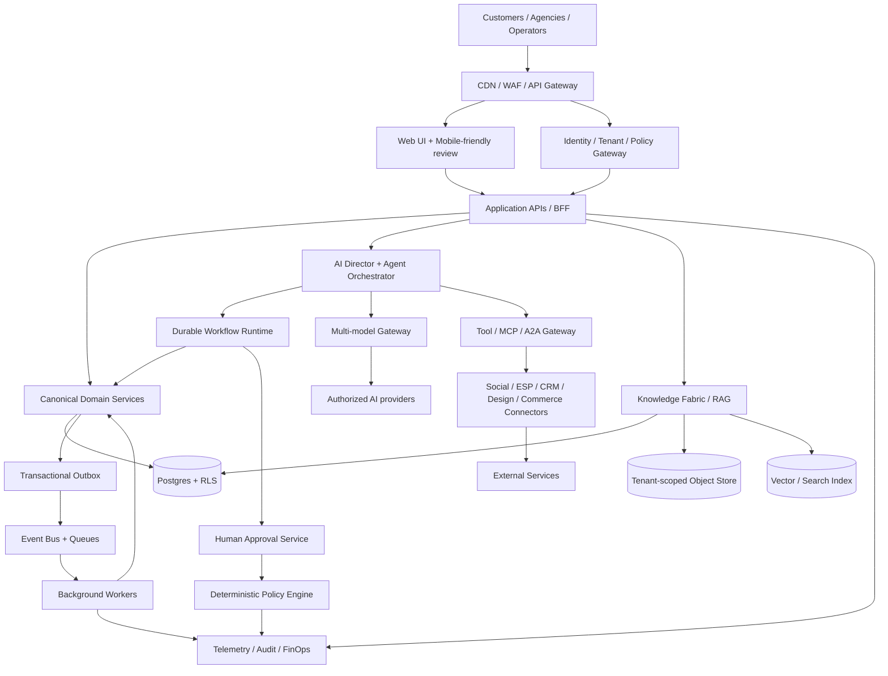
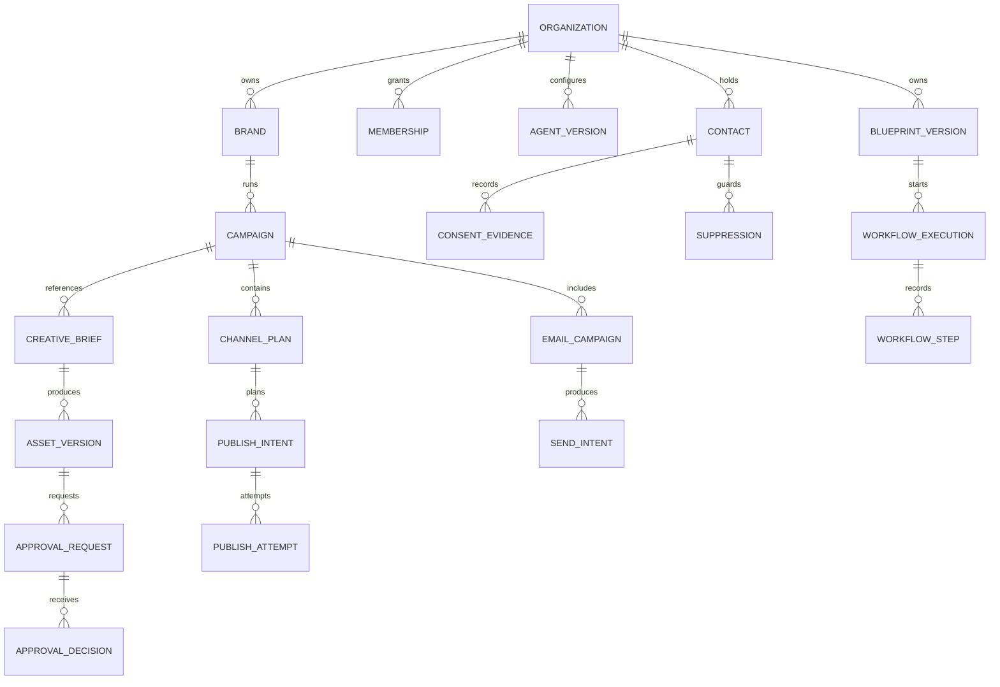

# AGENTIC MARKETING & COMMUNICATIONS OPERATING SYSTEM
## Enterprise Master Blueprint v2.1 — Consolidated Target-State Specification

**Document date:** 18 November 2026  
**v2.1 consolidation note:** All original v2.0 chapters, dataflow, invariants, sections and annexes are retained below. The approved v2.1 Part VI adds three engines (E34–E36), five workflows (WF37–WF41), and deepens revenue, customer, partner, content-authenticity and onboarding logic. Where the counts or target capability requirements differ, the Part VI amendment and updated typed registry govern. Nothing here constitutes production certification or live provider entitlement.


**Architecture status:** Approved **target-state engineering specification**; no assertion that target-state capabilities are already implemented, audited, certified, or available from third-party providers.  
**Product model:** Multi-tenant, multi-brand, agency-capable, AI/model-agnostic, MCP-native, A2A-capable commercial SaaS.  
**Design customer / controlled pilot:** Medsol; **commercial customer boundary:** independent product, independent subscription and tenant data, industry-neutral configuration.  
**Scope baseline:** Consolidates all approved requirements through pre-blueprint v1.1 and the ten subsequent platform-hardening recommendations.  
**Canonical rule:** **One business concept has one authoritative owner. No shadow domains, no duplicate approval engines, no separate agent-owned tables for the same fact.**

> **Executive acceptance statement:** Build a governed, intelligent marketing organization that can understand a customer's business and knowledge, research opportunities, interpret briefs, develop editable creative, execute social, compliant email and other permitted campaigns, manage customer relationships and loyalty, reason about products and pricing, measure credible commercial outcomes, and learn through controlled release procedures. Every consequential action is policy-authorized, attributable, recoverable and tenant-isolated.

### Document reading guide

- **Part I:** Product specification and non-negotiable boundaries.
- **Part II:** Runtime, domain ownership, agent/engine wiring, and integration architecture.
- **Part III:** Data model, security, approvals, workflows, knowledge and learning.
- **Part IV:** Studios, user journeys, commercialization, SRE and validation.
- **Part V:** Detailed inherited requirements, agent charters, schemas, tests and reference links.

**Specification authority:** This v2.0 target-state blueprint prevails over the earlier v0.9–v1.1 scope where descriptions differ. Existing repository code remains authoritative for current behavior until it is intentionally migrated and tested.

---
# PART I — PRODUCT CONTRACT

## 1. Product mandate, objectives and exclusions

### 1.1 Primary customer jobs
1. Discover what to market: industry research, market analysis, competitors, trends, customer segments, product/offer gaps and evidence-backed opportunities.
2. Decide what to do: strategy, campaign objectives, forecasts with uncertainty, media mix, promotion and pricing recommendations.
3. Make the materials: intake text/audio/PDF/docx/slide briefs; produce editable image/video, copy, landing pages, email, social and derivative assets.
4. Execute safely: social publishing, permissioned email, journey automation, community engagement, lead routing, approved external tools and integrations.
5. Improve outcomes: reporting, attribution, experimentation, product and brand intelligence, customer loyalty, skill upgrades and managerial decision support.
6. Govern the business: tenant/admin settings, agency delegation, role/attribute controls, approvals, budgets, connected providers, audit, consent and lifecycle management.
7. Extend the product: build agents, assemble teams, create workflows, author/deploy blueprints, install approved integrations, train skills through evaluated releases.

### 1.2 Explicit exclusions / constraints
- Not a bulk unsolicited-email service or personal-data harvesting product. Scraped addresses do not imply permission to mail.
- Not a substitute for the customer's ERP/PIM/CRM records. External commerce, price, stock, customer and invoice records retain their original source of truth unless a native authoritative subsystem is explicitly enabled.
- Not unrestricted web crawling; obey access control, privacy, platform contracts, source terms and rights.
- Not self-authorizing AI: models never approve their own restricted actions, edit tenant privileges, issue financial rewards or alter regulatory claims on their own.
- Not a claim of universal platform capability: every external action is gated by the connector's tested capability manifest, tenant account eligibility and access approvals.
- Not a promise that every AI/model/tool can be swapped transparently: compatibility, residency, tooling and quality must be checked before routing or fallback.

### 1.3 Product personas
Platform operator; organization owner; agency owner; agency staff; customer/brand administrator; marketing director; campaign manager; creative designer; brand guardian; product manager; pricing manager; finance approver; compliance/scientific reviewer; community agent; customer loyalty manager; sales user; analyst; auditor; external client reviewer; restricted end user.

### 1.4 Acceptance outcomes
- Customer signs up, configures roles, validates brand facts, connects eligible accounts, uploads a brief, creates and approves a campaign, publishes across supported channels, sends to consent-eligible audiences and views reconciled outcomes **without engineering intervention**.
- Agency manages multiple client tenants through scoped, revocable grants without cross-client disclosure.
- Authorized business user constructs a blueprint from prompt or visual nodes, tests it, obtains approvals, deploys it, observes executions and rolls back it with no bypass of domain invariants.
- Platform operator can trace and stop a harmful AI/tool/workflow execution, reconcile ambiguous external state and provide a forensic audit bundle.

## 2. Product-facing studios and navigation

| Workspace | Critical capabilities | Typical user |
|---|---|---|
| Executive Command Center | Objectives, campaigns, decision evidence, KPI tree, forecasts, risks, cost, strategic proposals and AI Director chat | Owner, CMO |
| Market Intelligence Lab | Web research, governed scraping, competitor/product tracking, demand/geo analysis, source ledger, opportunity scoring, watchlists | Strategist, analyst |
| Campaign & Journey Studio | Campaigns, calendars, orchestration, paid/organic channel plans, budgets, attribution, audience sequencing | Campaign manager |
| Creative & Brief Studio | Intake/parse briefs, editorial copy, design-app handoff, editable photos/videos, storyboards, DAM, versioning, review | Creative team |
| Social & Community Studio | Cross-network publishing, capability-aware previews, comments, inbox/cases, social listening, crisis | Social manager |
| Email & Messaging Studio | Contacts, consent, suppression, lists, segments, bulk sends, deliverability, newsletters, journeys, WhatsApp/SMS where approved | Lifecycle marketer |
| Conversion & Revenue Studio | Forms, landing pages, webinars, leads, ABM, CRM handoff, attribution, product offers, retention | Growth / sales |
| Agent Studio | Agent factory, personas, mission, knowledge, skills, model choices, tools, privileges, teams, evaluations, versions | AI admin |
| Workflow Studio | Visual agent/event/human task builder, branching, retries, simulation, operator inspections | Operations admin |
| Blueprint Studio | Natural-language/visual architecture authoring, contracts, build validation, staged deployment, dependency graph | Architect, admin |
| Knowledge & Learning Studio | Source access, evidence, graph, memory, corpus, evaluation, skills, experiment management | Knowledge manager |
| Administration & Settings | Org/agency/brand, custom roles, policies, integrations, consent, billing, security, retention, feature flags, audit | Scoped admins |
| Operations & Reliability | Traces, queue health, runs, approval backlog, publish reconciliation, kill switches, incidents, cost | Platform SRE |

**Access rule:** Navigation is permission-aware, but hiding a tab never constitutes authorization. APIs and worker commands independently enforce resource- and action-level policies.

## 3. Design invariants

**I01 Ownership:** Each aggregate has one write authority; read models are explicitly derived and rebuildable.  
**I02 Isolation:** Every user session, tool call, model prompt, memory access, queue message, asset and analytics query has immutable tenant and resource scope.  
**I03 Governed effects:** All external writes (publication, email, loyalty rewards, pricing pushes, ads, replies) require deterministic policy evaluation immediately before side effect.  
**I04 Immutable approvals:** Approval binds to exact content, rendition, audience definition, destination, scope, budget and relevant policy/version. Material modification revokes validity.  
**I05 Durable execution:** Workflows, leases, retries, outbox/inbox, reconciliation and human intervention must survive restarts.  
**I06 Evidence:** External facts and recommendations store sources, provenance, freshness and uncertainty, not model confidence masquerading as proof.  
**I07 Constrained learning:** Agents may propose changes; skill/model/prompt/tool/policy releases are evaluated, approved, versioned and reversible.  
**I08 Interoperability:** LLM providers, MCP, A2A and app connectors are capability- and policy-gated adapters, never direct pathways around authorization.  
**I09 Safe degradation:** Unsupported or revoked integration results in explicit blocked/manual modes, not synthetic success.  
**I10 Economic control:** Entitlements, credits, cost estimates and provider-billed reconciliation remain separable and independently audited.  
**I11 Reuse:** Before implementation, issue a code-level Reuse Map referencing existing owners. Extend canonical services first.  
**I12 Operability:** Owner, metrics, on-call actions, runbook, tests and rollback for each consequential path.

## 4. Existing system evidence and mandatory Reuse Map

**Inspected reference:** GitHub repository `Ashour158/medsol-ai-marketing-os`, default branch `main`, sampled at commit `b1900a7d0aba7e6d12b5a61752dfc7bf98548da5` (2026-11-18T16:17:01Z). Inputs reviewed: repository tree, README, `docs/architecture/08-module-boundaries.md`, `10-agent-roster.md`, `11-state-machines.md`, `14-approval-engine.md`, `docs/PHASE_1_2_CLOSEOUT_AND_PHASE_3_PRIORITIES.md`, and portions of `prisma/schema.prisma`. **This is a targeted documentation/schema inspection, not a full code audit or execution of tests.** The source describes an internal v0.2 governance slice and acknowledges production gaps.

| Target concept | Existing candidate / owner | Prescribed implementation action |
|---|---|---|
| AI CMO / Director; agent roster | `packages/agent-runtime/src/roster.ts`, `apps/api/src/marketing-brain.service.ts` | Extend signed manifests; map 10 cognitive roles to existing 13 roles, avoid competing director agent |
| Domain reasoning / work packages | `packages/agent-runtime/src/domain-work-packages.ts`, `apps/api/src/agent.service.ts` | Extend typed outputs and evaluators, retain original 13 domain deliverables |
| Agent execution ledger / brain runs | `BrainRunLedgerService`, `BrainRun`, `BrainRunStep`; `BrainDispatchWorker`, `BrainRunExecutorService` | Extend for dynamic teams and operation budgets; fix crash fencing and cost reconciliation before autonomy |
| Domain and campaign authority | `MarketingReadService`, `MarketingObjective`, `MarketingProduct`, `Campaign` | Add migrations and adapters; use existing campaign/product IDs and avoid parallel master data |
| Brand profile | `brand-master.service.ts`, `BrandMasterRevision` | Extend to versioned brand kits/claims; avoid shadow brand settings |
| Policy / identity | `BootstrapAuthGuard`, marketing permissions; OIDC; Entra integration deferred | Evolve to external SaaS IAM with SSO/ABAC; retain maker-checker boundary |
| Approval | `Approval`, `approval.service.ts`, existing decision events | Enhance version binding, audience hashes, delegated authority; do not introduce second approval engine |
| Durable events | `OutboxEvent`, `InboxEvent`, `OutboxPublisherService`, handoff consumer | Reuse durable delivery, adding DLQ, schema registry, fencing and reconciliation |
| Workflow | `WorkflowExecution`, `WorkflowStepExecution`, existing lease service | Extend as canonical workflow runtime for visual blueprints and human tasks |
| Model gateway & budget | `GovernedModelService`, `BoundedModelGateway`, `ModelBudgetService` | Add provider adapters, BYOK, model policy, actual billed vs estimated settlement |
| Learning / skills | `LearningSignal`, `AgentSkillProposal`, `SkillReleaseService` | Extend knowledge fabric and evaluated skill lifecycle; retain human release gate |
| Analytics | `MarketingMetricObservation`, `marketing-performance.service.ts` | Extend metrics normalization, customer attribution and reconciliation |
| Incidents / observability | `marketing-incident-response.service.ts`, worker-health service | Extend operational control plane and drills; preserve one incident owner |

**Mandatory discovery at start of every implementation tranche:** inspect source and migrations → identify existing use case/domain service → document **reuse / extend / new bounded domain / reject duplicate** → review API and event contracts → write regression tests → implement. Existing repository state must be re-audited at implementation time because this snapshot can become stale.

### 4.1 Reported repository status versus target
The repository's 2026-11-18 closeout note reports 13 governed drafting agents, internal brain step execution, optional model-backed drafting, clean-database migration CI, skill proposals and outbox delivery; it **does not** establish live commercial publishing, real paid-media execution, a multi-tenant SaaS billing system, permissioned email delivery, verified pricing changes or a full autonomous production marketing department. It specifically flags existing-database migration risk, model cost settlement uncertainty, crash recovery and live integration gaps. These become explicit release blockers, not ignored assumptions.

---
# PART II — SYSTEM, AGENTS, ENGINES AND CONNECTIVITY

## 5. Reference deployment and dataflow



- Control plane: tenant/brand settings, identity, policy, agent manifests, blueprint versions, provider capability manifests, billing, observability, emergency stops.
- Data plane: campaign workflows, content, research, CRM bridge, email/social dispatch, model and tool executions, analytics; strongly tenant-scoped.
- **MCP = tools/data**; **A2A = externally hosted agent tasks**; **internal command/event = canonical domain coordination**. Do not use MCP or A2A to bypass the domain API or authorize writes.
- Start with a **modular monolith + separate workers** (NestJS/TypeScript, Next.js, Prisma/Postgres, Redis for rate limits/locks, object storage and durable queues), not arbitrary microservices. Introduce distributed services after clear scalability or isolation evidence.
- Suggested orchestration: use existing workflow runtime if it passes crash/fencing requirements; evaluate established durable execution frameworks only if needed, with an explicit migration ADR. Kafka is optional and should not be added solely for architecture appearance.

## 6. Authoritative bounded contexts

| Bounded context | Owns authoritative records | Does not own |
|---|---|---|
| Tenancy & Commercial | Organization, agency relationship, client delegation, brand hierarchy, subscription, entitlement and tenant lifecycle | Customer contacts, campaigns |
| Identity & Governance | Membership, role grants, policies, approval decisions, audit authorization | Campaign copy, social provider tokens |
| AI Operations | Agent definitions/releases, skills, model policies, MCP/A2A registrations, evaluation releases, tool execution audit | Marketing facts |
| Business & Brand Knowledge | Brand profile, approved claims, brand kit, knowledge sources, source rights, validation state | ERP/PIM product master |
| Strategy & Campaign | Objectives, campaign plan, channel plan, budget request, campaign lifecycle | Individual email delivery attempts |
| Creative & DAM | Creative brief, copy version, storyboard, design source, asset lineage, rendition and rights | Campaign and approval decision |
| Audience & Consent | Contact/lead marketing mirror, consent proofs, preference events, suppression, segments, identity resolution | External CRM customer master |
| Social & Community | Social account connection metadata, publication intent/attempt, interaction and case | Social network's own post ID as writable truth |
| Email & Messaging | Send intent, audience snapshot, template version, delivery attempts, provider webhook and sender reputation | Consent proof; external ESP's proprietary analytics |
| Market Research & Acquisition | Source policy, crawl/fetch record, evidence snapshot, observed market entity | Canonical product prices/claims |
| Conversion & Growth | Landing page, form, conversion event, lead handoff, ABM plan, experiment assignment | CRM opportunity master |
| Analytics & Measurement | Metric definitions, observations, reconciliation, attribution model, experiment outcomes | Source provider raw mutation |
| Product & Pricing Bridge | Market-facing product projections, price proposal and approved offer; external refs and reconciliation | Price list/stock ledgers when ERP/PIM is authority |
| Loyalty & Retention | Loyalty program config and journey rules; **native points ledger only if enabled and explicitly authoritative** | External loyalty system's financial balances |
| Workflow & Reliability | Blueprint execution, task, lease/fence, outbox/inbox, reconciliation and incident runbook | Each domain's aggregate state |

Every cross-domain write is a command to the owner; events notify other domains. Derived tables/views carry source version and may be rebuilt; never masquerade as a new source of truth. Agency access is a revocable grant over client resources, not database tenant merging.

## 7. Cognitive responsibilities and agent roster

Ten reusable cognitive responsibilities: B01 Executive Director; B02 Business/Brand; B03 Market/Audience; B04 Strategy; B05 Creative; B06 Community; B07 Performance; B08 Risk; B09 Learning; B10 Commercial. These are **task-specialized policies** backed by shared model/routing infrastructure, not necessarily ten isolated LLM deployments.

| Agent | Scope / primary deliverables | High-risk boundary |
|---|---|---|
| AG-DIRECTOR Marketing Director | Objective decomposition, team assembly, plan approval packages, status, escalation | No direct external sends or privilege changes |
| AG-BRAND Branding | Brand system, positioning, guidelines, consistency audits, change proposals | Brand policy change requires authorized human |
| AG-PRICE Pricing & Promotions | Margin scenarios, competitor pricing evidence, proposal, promotion plan | No direct price push, spend or discount publication without approval |
| AG-PRODUCT Product Marketing | Product profile, claim evidence, comparison, launches, stale-change detection | Never overwrite ERP/PIM or assert regulatory approval without evidence |
| AG-LOYAL Loyalty | Segments, retention, loyalty offers, churn hypotheses, loyalty journeys | No unaudited points issuance or unauthorized customer profiling |
| AG-MARKET Market Intelligence | Source plan, competitor reports, evidence-backed market maps, opportunity briefs | No prohibited access or unsanctioned contact harvesting |
| AG-CREATIVE Creative | Parsed brief, storyboard, editable design reference, media variants, review tasks | No unlicensed assets or unapproved public claims |
| AG-SOCIAL Social Ops | Channel plans, drafts, schedule proposals, publish reconciliation | Only exact approved external publication |
| AG-EMAIL Email & Journey | Consent-eligible segments, email variations, journeys, deliverability reports | No send to non-eligible recipients; zero self-approval |
| AG-COMMUNITY Community & Reputation | Interaction triage, response drafts, case/escalation plans | No crisis commitments or sensitive responses without human |
| AG-ANALYTICS Performance | Scorecards, attribution caveats, test results, recommendations | Does not edit authoritative metrics |
| AG-GOVERNANCE Risk Review Assistant | Risk assessment, policy evidence, claims review packet | Advisory only; E25/humans authorize |

**Mapping rule:** existing repository roster contains 13 named directors; v2's 12 visible specialist personas are **UX/capability aliases and extensions**, not a forced replacement or additional 12 duplicated production agents. Registry holds a `canonical_agent_id`, `persona_id`, `brain_capability_ids` and underlying existing `domain_owner`. Every original agent retains migration identity and audits. Team assembly may choose logical personas, never create shadow authority.

### 7.1 Agent contract (minimal example)
```yaml
apiVersion: marketing.agent/v1
id: ag-pricing
version: 2.0.0
ownerDomain: commercial-pricing
mission: "Recommend defensible, policy-compliant prices and promotions"
brainCapabilities: [B02, B03, B07, B08, B10]
inputs:
  - type: PricingObjective
    schema: schemas/pricing-objective.v1.json
outputs:
  - type: PricingRecommendation
    schema: schemas/pricing-recommendation.v1.json
knowledge:
  scopes: [tenant, brand, product, approved-market-evidence]
  sensitivityCeiling: confidential
models:
  capabilityPolicy: pricing-analysis
  primary: tenant-policy-selected
  fallback: policy-approved-only
tools:
  - name: pricing.readCatalog
    effect: read
  - name: market.readEvidence
    effect: read
  - name: pricing.proposeOffer
    effect: draft-only
autonomy: A1
limits:
  maxDelegations: 5
  maxWorkflowDepth: 8
  maxEstimatedCostUsd: 15
  maxWallClockSeconds: 300
approval:
  externalPriceWrite: [finance-approver, commercial-owner]
  externalPromotion: [brand-approver, finance-approver]
escalation:
  lowEvidence: human-review
  negativeMargin: block
release:
  evaluationSuite: eval/pricing/v1
  requiredApproval: agent-release-manager
```

#### Every agent must expose
Identity and owner; task taxonomy; business expertise; mission and non-goals; data classifications; permitted tools and trust level; typed input/output contracts; memory partitions; default reasoning plan; handoff/collaboration protocols; fallback/stop conditions; budgets, rate and time limits; evidence policy; quality metrics; evaluation datasets; security red-team corpus; assigned model capabilities; skill dependencies; version and release channel; telemetry and operator playbooks.

### 7.2 Agent reasoning and execution loop
`Request → Authenticate/scope → Interpret objective → Retrieve authorized evidence → Form bounded plan → Validate plan and budgets → Choose tools/models → Execute reversible steps → Verify outputs → Request approval for side effects → Commit via domain commands → Report evidence and uncertainty → Capture feedback for evaluation.`

Block self-escalation, agent-to-agent credential transfer, recursive delegation without depth limit, untrusted data as instruction, publication based solely on generated confidence and fallback outside tenant policy. Allow parallel agents to disagree; a policy/authority rule plus human escalation resolves conflict, not majority vote.

## 8. The 33 logical engines: authoritative contract catalog

| Engine | Primary ownership / contract | Required input → output |
|---|---|---|
| E01 Business Discovery | Business profile intake | Website/documents → reviewed BusinessProfile |
| E02 Brand Knowledge | Brand definitions and claims | Brand kit/edits → BrandPolicyRevision |
| E03 Market Research | Research synthesis | Source plan → cited MarketStudy |
| E04 Audience Intelligence | Segment hypotheses | Signals + consented data → AudienceInsights |
| E05 Knowledge Retrieval | Evidence retrieval | Query/scopes → source-backed EvidencePack |
| E06 Campaign Strategy | Campaign business lifecycle | Objective → CampaignPlan |
| E07 Editorial Planning | Content calendar projections | Approved plan → EditorialCalendar |
| E08 Scheduling Optimizer | Timing and frequency recommendations | Historic metrics → ScheduleProposal |
| E09 Commercial Opportunity | Marketing-to-revenue planning | Signals → OpportunityRecommendations |
| E10 Copywriting | Versioned copy variants | Brief+facts → CopyVersion |
| E11 Creative Production | Edit/render orchestration | CreativePlan → source Design + Rendition |
| E12 Localization | Language and cultural adaptation | Approved draft → locale-specific version |
| E13 Content Quality | Factual/rights/format assessment | Asset+claims → QAResult |
| E14 Digital Asset Management | Media artifact authority | Import/design → VersionedAsset/License |
| E15 Publishing | Social dispatch and reconciliation | ApprovedPostIntent → VerifiedPublication/Unknown |
| E16 Platform Connectors | Official external platform adapters | Scoped command → provider-specific result |
| E17 Social Listening | Supported audience monitoring | Allowed feeds → ObservedInteraction |
| E18 Community Management | Case routing / replies | Interaction → Case/DraftReply |
| E19 Reputation & Crisis | Incident triage | Signal → IncidentProposal/response packet |
| E20 Analytics | Metric normalization | Source events → MetricsLedger |
| E21 Attribution | Conversion attribution | Channel+conversion → AttributionResult |
| E22 Experimentation | Controlled tests | Hypothesis → ExperimentAssignment/Result |
| E23 Learning & Optimization | Evaluated improvements | Outcomes → ProposedSkill/PolicyTuning |
| E24 Workflow Orchestration | Durable execution and timers | Versioned Blueprint → WorkflowExecution |
| E25 Approval & Policy | Deterministic authorization | Actor+resource+action → Permit/Require/Block |
| E26 Quality & Reliability | Eval/incident/operability | Traces+tests → Report/Incident |
| E27 Multi-Model Gateway | Provider routing, budget, reconciliation | LLMTask → Schema-validated ModelResult |
| E28 MCP & Tool Gateway | Tool registry and execution | Scoped ToolIntent → AuditedToolResult |
| E29 Audience & Consent | Contact permissions + suppression | ContactEvent → ConsentStatus/Segment |
| E30 Email & Journey | Email journey and message intent | ApprovedJourney → DeliveryIntent |
| E31 Email Delivery & Reputation | ESP dispatch, events, suppression coordination | DeliveryIntent → DeliveryReceipt/ProviderStatus |
| E32 Brief & Design Coordination | Ingest/parse briefs and creative jobs | BriefSource → CreativeSpec/DesignTask |
| E33 Governed Web Acquisition | Source screening/fetch/extract | Approved SourceRequest → EvidenceSnapshot |

**Note:** These 33 labels organize capabilities; they are not a mandate for 33 microservices or 33 databases. New commercial needs (landing page, product, pricing, loyalty, agency operations) must first be mapped to existing domain owners; create a new bounded domain only when invariants or transactional authority demand it.

## 9. Agent connectivity and collaboration fabric

### 9.1 Supported patterns

| Pattern | Transport/contract | Execution semantics | Security rules |
|---|---|---|---|
| Direct task delegation | Typed internal command | Durable async default; sync only for bounded lookup | Scope propagation, delegation depth |
| Sequence / DAG | Versioned workflow graph | Ordered, checkpoints and compensation | Permissions each node |
| Parallel fan-out / join | Durable child tasks | Concurrency budgets, partial result rules | Aggregate evidence and isolation |
| Event-triggered | Canonical versioned domain events | At-least-once delivery + idempotent consumers | Event schema/owner validation |
| Shared artifacts | Artifact ID + immutable version/hash | Producer publishes; consumers refer to one artifact | Per-artifact ACL and rights |
| Peer debate/critique | Bounded review tasks | Timeboxed, independent reviewers, disagreement record | No authority from votes alone |
| Dynamic team assembly | Registry query / role assignment | Create ephemeral task team from templates | Capabilities no greater than caller delegation |
| A2A remote agent | Authenticated A2A adapter | Task, status, artifact; asynchronous, cancellable where supported | Approved agent card and trust, no raw secrets |
| MCP tool/resource | MCP Client/Server adapter | Tool invocation, data retrieval, elicitation if supported | Tool-level policy; egress allowlist |
| Human task / approval | Inbox/notification + durable workflow | Long-running and reassignable | Maker-checker, expiry and reauth |
| Schedule / signal | Timers, webhooks, event subscriptions | Deduplication, quiet hours, quotas | Tenant consent and authenticated event source |
| Manual operator override | Incident console | Block/cancel/reconcile, compensated where feasible | Privileged, dual control for risky action |

### 9.2 Canonical task envelope
```json
{
  "task_id": "uuid", "tenant_id": "uuid", "brand_id": "uuid",
  "initiating_actor": {"type":"human", "id":"uuid"},
  "effective_scopes": ["campaign:read", "creative:draft"],
  "parent_run_id": "uuid", "correlation_id": "uuid", "causation_id": "uuid",
  "agent_id": "ag-creative", "agent_version": "2.0.0",
  "input_schema": "CreativeBrief.v2", "input_ref": "artifact://...",
  "data_classification": "internal", "region_policy": "EU-allowed",
  "deadline_at": "2026-11-20T14:00:00Z",
  "budget": {"max_cost_micros": 5000000, "max_calls": 30},
  "approval_requirement": "draft_only",
  "idempotency_key": "tenant:workflow:step:attempt1",
  "result_ref": null
}
```
Use validated, immutable task schema versions; redact PII/secrets from traces; `tenant_id` and privileges come from trusted server context, not client-provided headers.

### 9.3 Connection creation UX
`Select source agent/node → select target → inspect contracts → choose synchronous/async/event/artifact/human mode → set mapping + timeout → configure retry/compensation → check scope/cost/data residency → compile → simulate → approval → deploy`. A failed contract or permission check blocks publication of the blueprint.

### 9.4 Distributed correctness
Commands may be delivered more than once; **exactly-once effects are implemented through domain idempotency and reconciliation, not assumed from message transport**. For irreversible external operations, persist an intent/attempt before dispatch; if provider response is ambiguous, mark `OUTCOME_UNKNOWN`, fetch provider state or require operator resolution before retry. Lease/fencing tokens prevent stale workers from committing. Every fan-out node declares join semantics (`ALL`, `ANY`, `QUORUM`, `REVIEW_REQUIRED`), deadline and cancellation behavior. Cycles require explicit iteration bounds.

## 10. AI provider gateway / model governance

### 10.1 Architecture
One `ModelTask` interface, provider-specific adapters, model catalog, structured output validation, routing policy, cost reservations, data-policy filters, retrieval scoping, trace emission and provider settlement. OpenAI/GPT, Anthropic/Claude, Google/Gemini and authorized compatible/self-hosted models are pluggable; third-party pricing and capability metadata are refreshed/versioned, never guessed.

**Routing dimensions:** allowed provider by tenant/brand/region, task modality, required structured output, tool calling, context size, latency target, benchmark score, BYOK/platform key availability, forecast cost, rate limit and incident status. Score only among providers that satisfy hard policy gates. Failure from one provider may fall back only to an equally authorized compatible one; unknown price/egress settings must block side effects.

**Controlled model actions:** `DRAFT`, `RESEARCH_SUMMARY`, `ANALYZE`, `CLASSIFY`, `EXTRACT`, `GENERATE_IMAGE`, `GENERATE_VIDEO`, `TOOL_PROPOSAL`, `REVIEW`. LLM result is advisory and schema validated; domain service independently authorizes effects.

**Billing invariant:** `reserved_estimate`, `observed_usage_estimate`, `provider_invoice_amount`, `credited_adjustments`, `final_charge` are distinct records. Existing cost settlement code is a reuse candidate with known finance-grade reconciliation gap.

### 10.2 Model gateway operational tests
Contract tests for every adapter; rate-limit recovery; empty/invalid structured output; tool arguments with malicious payloads; provider unavailability; provider privacy disallow; token-expiry; duplicated billing callbacks; different tokenizers; media-cost unpredictability; concurrent spending cap; region mismatch; cost ledger reconciliation; model-version deprecation; human override for model egress.

## 11. MCP / A2A / external platform connectivity

### 11.1 MCP client and server
- Registry: MCP server identity, owner, endpoint, protocol version, auth scheme, tools/resources/prompts, risk tier, tenant authorization, network allowlist, data categories, version/checksum and change history.
- Client: discovery, capability caching with expiry, tool schema validation, request signing/auth where applicable, deadlines, concurrency/egress bounds, read/write classification and tenant-isolated credentials.
- Server: expose **only** policy-mediated selected platform functions to external authorized clients; avoid raw database mutation or unscoped public tool publication.
- Threat defenses: server/tool description poisoning, prompt injection, SSRF, DNS rebinding, redirect abuse, token passthrough, confused deputy, credential exfiltration, insecure logging, unexpected tool version changes and tainted resources. Newly installed third-party MCP enters quarantine/review before agent use.
- Trust tiers: `T0 internal signed`, `T1 vetted provider`, `T2 tenant-registered restricted`, `T3 blocked/quarantined`. Tool trust level does not imply user authority.

### 11.2 A2A support
Approved remote agents have signed/validated Agent Cards where supported, identity, endpoint, task schemas, auth scheme, allowed scopes, status/artifact mapping, independent rate limits, task expiry and cancellation strategy. Treat remote agent output as external data until verified. Capabilities exposed to a remote agent are the intersection of tenant, initiating actor, workflow and remote-agent permissions.

### 11.3 Connector contract and capability manifest
```json
{
  "connector_id": "social.linkedin", "connector_version": "2026.11",
  "provider": "linkedin", "tenant_connection_id": "uuid",
  "account_ref": "opaque-provider-id",
  "capabilities": {
    "publish_text": {"enabled": true, "scope": "approved-scope"},
    "publish_video": {"enabled": "capability-checked"},
    "read_comments": {"enabled": "app-review-dependent"},
    "respond_message": {"enabled": false}
  },
  "rate_limit_policy_ref": "provider-updated",
  "authorization_status": "APPROVED_BY_PROVIDER",
  "credential_ref": "vault://tenant/...",
  "last_verified_at": "2026-11-18T00:00:00Z"
}
```
**Illustrative manifest only**, not actual entitlement. A production manifest contains exact platform scopes/limit versions discovered and verified at connection time; unsupported actions must render disabled/unsupported rather than silently substitute browser scraping or prohibited automation.

### 11.4 Platform families
Organic social: LinkedIn, Meta Facebook/Instagram, YouTube, TikTok, X, Pinterest where approved; email/ESP: SES, SendGrid, Mailgun, Brevo; creative: Canva, Adobe Express, Figma and authorized media generation services; business: Salesforce, HubSpot, Zoho, Dynamics, ERP/PIM/DAM; analytics: GA4, BI, tagged landing pages; web/research: lawful APIs and permitted websites; messaging: WhatsApp Business, SMS/RCS and push providers; payments/billing: processor and accounting integration; identity: enterprise OIDC/SAML/SCIM as licensed.

**Proven external constraints:** LinkedIn Community Management uses an application review/access process; social network permissions and account capabilities vary; major inbox providers require authentication and unsubscribe controls for marketing email; model/tool protocols evolve. Architecture must capability-detect, version-pin, revalidate and provide manual fallback.

## 12. Knowledge Fabric, memory and learning

### 12.1 Three trust strata and five memory scopes
- **Authoritative:** validated brand/claims, governed price/product refs, consent decisions, tenant policies, approval decisions and signed commercial source records.
- **Evidence:** licensed/source-backed research, document extracts, web snapshots, conversation records with source IDs/rights/freshness.
- **Hypothesis:** model inference, opportunity ranking, estimated TAM, sentiment, forecast, draft strategy, candidate skill. Never silently elevate to authoritative fact.

Memory scopes: global platform public/approved knowledge; tenant; brand; campaign/customer journey; task/ephemeral agent execution. Confidential tenant memories are never used to train a shared model or enrich cross-tenant outputs without an independently authorized data-use program. Source data and derived vectors inherit deletion, residency and access policy.

### 12.2 Hybrid retrieval path
`Query → classify sensitivity → authorize tenant/brand/purpose → resolve entities → hybrid lexical+vector retrieval → optional knowledge graph links → rights/freshness filter → rerank → evidence pack with citations → model → factual/claim validator → draft/output`. Persist retrieval evidence IDs and index versions for reconstructability. Sources with unclear rights or material contradictions generate a `KNOWLEDGE_REVIEW_REQUIRED` task. Permit correction, expiration, legal hold, soft delete, hard deletion where appropriate, index retraction and versioned reindexing.

### 12.3 Knowledge entities
`KnowledgeSource`, `DocumentVersion`, `Chunk`, `Entity`, `EntityRelation`, `EvidenceReference`, `Claim`, `ClaimApproval`, `Citation`, `UsageRight`, `KnowledgeRevision`, `MemoryRecord`, `RetentionPolicy`, `LearningSignal`, `SkillCandidate`, `SkillRelease`, `EvaluationResult`, `DataLineageEdge`.

### 12.4 Controlled learning lifecycle
`Observation → Signal eligibility/consent → Feature or skill proposal → Evidence triage → Offline evaluation → Red-team and regression tests → Release approval → Canary to test tenant → Metrics comparison → Controlled rollout → Monitor → Rollback if regression`.

No unreviewed runtime prompt self-edit, tool-scope expansion, production model fine-tune with customer secrets, or automated policy changes. Keep skill and knowledge versions separately so content refresh does not silently change executable privileges. Track overfitting and reward hacking: optimize qualified conversions, retained customers and trustworthy information, not only superficial engagement.

### 12.5 Agent quality scorecard
Weighted score is a proposed rubric, configurable and risk-adjusted: task completion 20%, factual/evidence correctness 20%, authorization/security 20% (hard gate), output quality 15%, workflow reliability 10%, cost efficiency 10%, user feedback 5%. No weighted score compensates for unauthorized access, tenant leakage, prohibited send or bypassed approvals. Evaluate by task type and audience, not one aggregate vanity score.

## 13. Agent Studio, Workflow Studio and Blueprint Studio

### 13.1 Agent Studio
Template library and natural-language agent factory; versioned manifests; mission, brain capabilities, tool list, knowledge sources, memory policies, language, autonomy, costs, human supervisor, evaluation corpus, test/simulate, staged deployment, pause/retire, audit. Agent teams are references to agents, not duplicate state owners. Marketplace extensions are signed packages with scopes, license, provenance, migration and revocation hooks.

### 13.2 Workflow Studio node taxonomy
`TRIGGER`, `CONDITION`, `TRANSFORM`, `AGENT_TASK`, `DOMAIN_COMMAND`, `MCP_TOOL`, `A2A_TASK`, `EVENT_WAIT`, `HUMAN_TASK`, `APPROVAL`, `SCHEDULE`, `PARALLEL`, `JOIN`, `LOOP_BOUNDED`, `COMPENSATE`, `ERROR_HANDLER`, `END`. Every node defines schema I/O, idempotency, retries, timeouts, compensation feasibility, side-effect category, permissions, budgets, data classes and observable run state.

### 13.3 Blueprint Studio compiler
Stages: `NATURAL_LANGUAGE_OR_VISUAL_DRAFT → PARSE → TYPE_CHECK → DOMAIN_OWNER_CHECK → POLICY_STATIC_CHECK → GRAPH_CHECK → COST_ESTIMATE → SIMULATE → EVALUATE → CHANGE_REVIEW → SIGN → STAGE → PROMOTE → RUN → OBSERVE → ROLLBACK/RETIRE`.

Compile-time failures: unknown owner; type mismatch; cross-tenant reads; missing approval gate; unsafe tool authority; unbounded cycle; unowned state write; unauthorized data egress; no timeout; unsupported provider action; missing compensation decision for irreversible steps; invalid consent predicate for outbound communication; duplicate event consumer owner; undefined pricing/reward ledger; missing output evidence.

**Version pinning:** An active workflow execution remains pinned to the blueprint, skill and connector manifest versions it started under unless migrated by an explicitly approved transition. Staged upgrade runs migration validation against in-flight executions; never mutate past approval evidence.

### 13.4 Example workflow DSL (illustrative)
```yaml
apiVersion: marketing.blueprint/v1
id: approved-product-launch
version: 1.0.0
ownerDomain: campaign
trigger: {type: manual, permission: campaign:create}
inputs: {schema: ProductLaunchBrief.v1}
steps:
  - id: research
    type: agent_task
    agent: ag-market
    output: MarketResearchPack.v1
    timeout: PT10M
  - id: develop
    type: parallel
    branches:
      - {id: creative, agent: ag-creative, type: agent_task}
      - {id: pricing, agent: ag-pricing, type: agent_task}
      - {id: product, agent: ag-product, type: agent_task}
    join: ALL
  - id: qa
    type: domain_command
    command: content.EvaluateForApproval
  - id: approve
    type: approval
    policy: content.external_publish.v1
  - id: publish
    type: domain_command
    command: social.PublishApprovedVersion
    sideEffect: irreversible_external
    preflightPolicy: social.publish.v1
    idempotency: workflow-step-version
    onUnknownResult: operator_reconcile
outputs: {schema: LaunchExecutionReport.v1}
release: {required: [simulation-pass, policy-signoff, owner-signoff]}
```

Blueprints are stored as versioned executable definitions plus visual graph layout, never as screenshots only. Provide JSON/YAML export, signed import with dependency scan, diff, lineage, version migration and rollback. Visual builder and natural-language generator must compile to the **same** canonical DSL/IR.

## 14. Settings center and permission framework

### 14.1 Settings taxonomy
Organization, agency and brands; users/groups/roles; SSO/MFA/SCIM; agent configuration and autonomy; AI providers/BYOK; MCP/A2A catalog; social/email/creative/business connections; policies and approvals; budgets/quotas; brand kits and industry packs; product/price source mappings; contacts/consent; loyalty rules; domains and sender authentication; notifications; retention, data residency and privacy; billing; audit; incident switches; API keys; support/legal settings.

### 14.2 Authorization algebra
`PERMIT = tenant_active AND authenticated_actor AND allowed_role_scope AND ABAC_resource_match AND subscription_entitlement AND provider_capability AND data_policy AND tool_policy AND valid_approval_if_required AND budget_ok AND no_emergency_hold`.

Any negative gate denies execution. Customer-defined roles can only **narrow or configure within** platform policy ceilings. Delegated agency rights are explicit, revocable, least-privilege and time-bound. Never use `tenant_id` supplied by the client as a selector without identity-bound verification.

### 14.3 Illustrative permission matrix (configured per customer)

| Resource/action | Platform superadmin | Tenant admin | Marketing director | Brand manager | Creator | Product/pricing mgr | Finance approver | Compliance reviewer | Agency collaborator | Auditor |
|---|---|---|---|---|---|---|---|---|---|---|
| Tenant policy ceiling | Platform only | View | — | — | — | — | — | View | — | View |
| Tenant membership | Support governed | Manage | Limited | Limited | — | — | — | — | Scoped | Read evidence |
| Brand configuration | — | Manage | Propose | Manage | Read | Read | Read | Approve regulated | Per grant | Read |
| Campaign/creative | — | Manage | Own/approve if delegated | Approve brand | Draft | Propose | Review spend | Review claims | Per grant | Read |
| Pricing changes | — | Configure route | Propose | — | — | Propose | Approve spend/margin | Review regulatory | — | Read |
| Loyalty rewards | — | Configure route | Propose | — | — | Propose | Approve liability | Review compliance | Per grant | Read |
| Publish/send | Break-glass only | Policy-governed | Approved scope | Approved scope | Draft only | Draft only | Budget only | Claims approval | Per grant | Audit |
| Models/MCP/keys | Platform policy | Manage tenant | Use allowed | Use allowed | Restricted | Restricted | Cost read | Tool risk review | Scoped | Read masked |
| Audit | Scoped support | Read tenant | Read campaigns | Read brand | Own actions | Own actions | Read spend | Read reviews | Own authorized | Read/Export |

A platform superadmin cannot casually read a tenant's confidential content; break-glass support requires justification, privileged session, scope, expiry and immutable audit. Role names above are **starting templates**, not hardcoded access authority.

## 15. Approval, risk tiers and action gates

**Autonomy:** `A0` observe, `A1` draft, `A2` execute exact approved work, `A3` bounded low-risk autonomy, `A4` restricted human-controlled action category—not unrestricted autonomy.

**Risk:** R0 read, R1 internal draft, R2 ordinary external communication, R3 high-volume/spending/regulated claims, R4 financial ledger changes, crisis, privileges, irreversible data deletion or exceptional access. Risk rules may be raised by region/industry/tenant but never downgraded below platform hard floors.

| Operation | Minimum required conditions |
|---|---|
| Source scrape / research | Domain/purpose access policy; rate limit; PII/rights classification; audit |
| Internal content draft | Brand and data policy, budgets, QA flags |
| New public social content | Exact rendition + account + window; brand review, qualified claim review if relevant |
| Approved social publication | Token/account preflight, approval validity and hash match, idempotent dispatch |
| Email bulk send | Lawful audience basis and provenance, suppression, sender auth, content review, audience snapshot, volume/country/quiet-hours validation, human release |
| Community public response | Approved template for strictly low-risk; human for complaints, regulated claims, crisis and commercial commitments |
| Pricing/discount changes | Product and currency evidence, margin floor, validity windows, finance/commercial approval, source-system write API authorization |
| Loyalty point/reward issue | Eligibility, fraud/abuse checks, ledger idempotency, redemption liability approval and transaction reconciliation |
| Paid media launch/expansion | Budget cap, ad platform scope, creative approval, financial authority, escalation on anomalies |
| Model/MCP/A2A connector install | Admin allowlist, risk assessment, provider DPA/region checks, scopes, secrets and budget controls |
| Blueprint/skill release | Staging eval + regression + security + owner signature + operator rollback |
| Crisis statement | Designated senior approver, review packet and incident state |
| Delete/export/retention override | Privacy policy, privileged reauthentication, hold checks, audit and dual review where configured |

### 15.1 Approval object
`ApprovalRequest(tenant, brand, object_type, object_id, object_version, content_hash, media_render_hash, audience_snapshot_hash, destination_refs, time_window, price_offer_ref, budget_ceiling, risk, required_roles, policy_version, expiry, created_by, condition_set)`.
`ApprovalDecision(decision, reviewer_id, reviewer_role, auth_strength, timestamp, rationale, constraints, signature_or_integrity_proof)`. A later edit to relevant scope invalidates prior approval; refresh and reapprove rather than editing history. Rejection and delegation are explicit immutable events.

### 15.2 Emergency control
Kill switches at global, tenant, agent, workflow, model-provider, MCP server, platform connector, social account, email sender and paid campaign scopes. The stop blocks new effects immediately; queued work receives hold; in-flight external operations reconcile. A stop **does not guarantee reversal** of already delivered email, published post or purchased ad—display this limitation and provide compensating instructions.

---
# PART III — WORKFLOWS, DATA AND SECURITY

## 16. Canonical workflow catalog — 36 families

| ID | Workflow family | Trigger → target terminal state | Key approval / failure guard |
|---|---|---|---|
| WF01 | Tenant and agency onboarding | subscription → ACTIVE/REJECTED | Verify ownership, domain, seats, isolation and entitlements |
| WF02 | Brand intelligence onboarding | new brand → VALIDATED_BRAND | Website facts quarantined pending approval |
| WF03 | Social account connection | OAuth start → CONNECTED/REVOKED | Tenant-bound callback/state, scopes and provider check |
| WF04 | Marketing strategy | objective → APPROVED_STRATEGY | Source quality and delegated budget |
| WF05 | Campaign plan / calendar | strategy → APPROVED_PLAN | Conflict, budget and content constraints |
| WF06 | Content production | brief → QUALITY_PASSED_ASSET | Versioning, claims, license and editable-source tracking |
| WF07 | Content approval | review request → APPROVED/REJECTED | Maker/checker, immutable hashes and expiry |
| WF08 | Social publishing | approved post → CONFIRMED/UNKNOWN/FAILED | Preflight, idempotency, status reconciliation |
| WF09 | Community response | interaction → CLOSED/ESCALATED | Consent, sensitivity, allowed API action |
| WF10 | Crisis response | risk signal → RESOLVED | Incident command chain, senior signoff |
| WF11 | Analytics and learning | observed results → EVALUATED | Source reconciliation and no automatic risky update |
| WF12 | Subscription/offboarding | plan/state event → CLOSED/ACTIVE | Grace period, export/delete/retention, key revocation |
| WF13 | AI provider lifecycle | add/rotate provider → HEALTHY/REVOKED | DPA, residency, key validation and budget |
| WF14 | MCP server lifecycle | register → VERIFIED/QUARANTINED | Server trust, tool scopes and risk approval |
| WF15 | Enterprise/platform connection | connect → CAPABILITY_VERIFIED | OAuth scopes, API tier, quotas, revocation |
| WF16 | Contact/consent intake | import → ELIGIBLE/QUARANTINED | Provenance, identity, purpose, suppression |
| WF17 | Email campaign | brief → SENT/RECOVERING | Audience snapshot, sender, approvals, rate caps |
| WF18 | Delivery/preference event | webhook → RECONCILED | Verify signatures, dedup, unsub/suppress |
| WF19 | Brief to creative design | uploaded brief → APPROVED_ASSETS | Requirements, editable source, visual QA |
| WF20 | Web source acquisition | source request → INDEXED/BLOCKED | Access, rights, PII, robots, SSRF controls |
| WF21 | Market report | research question → EVIDENCE_REVIEWED | Cite facts, note uncertainties, publish findings |
| WF22 | Settings and privilege change | admin request → ACTIVE/REJECTED | ABAC, platform ceiling, reauth, audit |
| WF23 | Brand revision | proposed kit/positioning → RELEASED | Brand owner, claim updates invalidate assets |
| WF24 | Price/promotion proposal | market/cost signal → APPROVED/REJECTED/EXPORTED | Margin, source-of-truth and finance signoff |
| WF25 | Product/portfolio lifecycle | product change → PROFILE_RECONCILED | PIM/ERP precedence, source freshness |
| WF26 | Loyalty/retention journey | lifecycle signal → CLOSED/RECONCILED | Consent, eligibility, transaction ledger |
| WF27 | Agent factory and registration | agent request → REGISTERED/REJECTED | Signed manifest, policy compile and evaluation |
| WF28 | Multi-agent team assembly | complex objective → TEAM_COMPLETED | Delegation bounds, task conflicts, evidence |
| WF29 | Workflow design and release | visual workflow → EXECUTABLE_VERSION | Graph typing, simulation, staged approval |
| WF30 | Blueprint compilation/deployment | blueprint draft → RELEASED/ROLLED_BACK | Invariants, migration and signed deploy |
| WF31 | Skill and learning release | proposal → CANARY/PROMOTED/REJECTED | Offline eval, red-team, human authorization |
| WF32 | Landing page/form conversion | campaign brief → LIVE/RETIRED | Cookie/consent, domain ownership, security |
| WF33 | Lead enrichment and CRM handoff | eligible conversion → ACKED/REJECTED | Data minimization, lead-dedup, CRM idempotency |
| WF34 | Paid advertising | approved media plan → ACTIVE/PAUSED/CLOSED | Hard spending caps, channel permissions, finance |
| WF35 | Messaging (WhatsApp/SMS/etc.) | authorized journey → DELIVERED/STOPPED | Provider templates, opt-in, suppression and quotas |
| WF36 | Proactive market/event watch | schedule/trigger → FINDING_REVIEWED | Source eligibility, dedup, no automatic sending |

**Common states:** `DRAFT`, `VALIDATING`, `WAITING_EXTERNAL`, `WAITING_APPROVAL`, `READY`, `RUNNING`, `BLOCKED`, `NEEDS_INTERVENTION`, `SUCCEEDED`, `FAILED`, `CANCELLED`, `OUTCOME_UNKNOWN`. Each workflow has its own domain-specific legal transitions and immutable transition ledger. Workers cannot invent state transitions from model text.

## 17. Critical end-to-end workflows and acceptance rules

### 17.1 WF19 + WF06 + WF07 + WF08 — Brief → editable creative → social publication
1. Ingest brief from typed text, PDF/docx/slide/audio; store source digest, uploader, classification, document sections and OCR/source limitations.
2. Parse deliverables, audience, geographic/industry constraints, budget, channels, approved claims, deadlines, formats and editable-source requirement into `CreativeBriefVersion`.
3. Validate business facts against versioned product, brand, rights and knowledge evidence; list unresolved assumptions.
4. AI Director delegates market research, positioning, pricing and brand guidance; collect parallel artifacts with source IDs.
5. Creative agent proposes concepts, short-form scripts, copy variants, storyboard and media output budget; select permitted model/tool.
6. Generate editable source in supported design service or mark artifact `RASTER_EXPORT_ONLY`; store source provider ID, export hash, license and expiry.
7. Run factual, claim, brand, copyright, accessibility, locale and provider-specific media/format QA; failed checks create revision tasks.
8. Route review to brand, technical/regulated reviewer, commercial approver if relevant; approval binds copy+media+destination+time.
9. On scheduled run, verify current authorization, channel API capability and token; persist PublishIntent and idempotency; dispatch.
10. Reconcile post ID/status; if ambiguous, hold; generate analytical measurement plan and notify operator on failure.

**Acceptance:** A material asset edit forces reapproval; no duplicate post after provider timeout; exact source-editability claim; unsupported format blocks with actionable explanation; cross-tenant asset unavailable.

### 17.2 WF16 + WF17 + WF18 — Bulk email and deliverability
1. Ingest contacts from first-party forms, approved CRM bridges or CSV with declared source/legal basis/purpose; validate record provenance and privacy notices.
2. Quarantine ambiguous or prohibited records; apply consent/preference/suppression and frequency caps; snapshot eligible cohort at send freeze.
3. Compose accessible responsive email and plain text version, link tracking rules, unsubscribe, sender identity and approved visuals.
4. Check domain control, SPF/DKIM/DMARC, recipient geography rules, sender reputation and ESP quota; calculate projected cost.
5. Approve immutable content hash, sender domain, audience definition/snapshot hash, maximum recipient count and window.
6. Persist `SendIntent` and schedule shard batches with deterministic per-contact message ID; re-check suppression immediately before each send.
7. ESP adapter sends within rate/tenant budgets; accept signed bounce, complaint, delivery and unsubscribe webhooks; dedupe and reconcile.
8. Immediately block future marketing sends for unsubscribed/suppressed contacts. On uncertain provider response, reconcile before repeat.
9. Report deliveries, clicks, conversions, complaints and CRM feedback; do not treat opens as exact unique human reads.

**Acceptance:** Unsubscribed address never receives next marketing send; replay does not duplicate sends; suppression remains enforceable during subscription suspension; no permission inferred from scraping; cap holds work before overspend.

### 17.3 WF24 — Pricing agent offer recommendation
`Source cost/list/stock + currency + valid dates → Competitive evidence → Margin and tax assumptions → Scenario/discount analysis → Policy check → Finance/commercial review → Approval tied to product, price list, region and effective window → ERP/commerce write via authorized command if enabled → Reconcile → Update dependent campaigns/links`.

**Acceptance:** Missing cost or stale currency blocks automatic published claim; negative margin or outside delegated discount routes higher; promotions expire safely; source ERP remains authority; all overrides audited; agents cannot collude to lower floor.

### 17.4 WF25 + WF23 — Product and brand change propagation
Receive signed product/brand change from authoritative source; create comparison to previous approved version; identify affected claims, images, landing pages, social queue, email drafts, pricing offers and knowledge chunks via lineage graph; mark material dependents `REVIEW_REQUIRED`; suspend scheduled publication where claim is invalid; request owners' decisions; refresh approved references and audits. Avoid bulk silent rewriting of already published history; propose corrections when needed.

### 17.5 WF26 — Loyalty lifecycle
`Permitted customer event → Consent/purpose check → Eligibility and churn hypothesis → Reward economics → Program rules → Authorized offer → Ledger reservation/commit (if native) → Customer notification → Redemption/expiry/reversal → Reconciliation → Retention experiment report`. Rewards must never be issued by an LLM directly. If third-party loyalty system is authoritative, native platform stores projection and idempotent external intent only.

### 17.6 WF20 + WF21 + WF36 — Market watch / governed scraping
`Monitor plan → Source legal/policy assessment → Rate-limited acquisition → Structured extract → PII/rights filters → Source snapshot + entity dedup → Fact/estimate classification → Market hypothesis → Analyst review → Cited report → Opportunity recommendation → Optional campaign draft, NOT an automatic send`.

**Acceptance:** URLs that resolve into private networks or disallowed destinations are rejected; block CAPTCHA/paywall bypass; record inaccessible-source and sample bias; every factual quote/price has source and observation time; no scraped address automatically enters marketing cohort.

### 17.7 WF27–WF31 — Custom agent / workflow / blueprint release
Create agent and workflow from natural language or UI; assign canonical owners and schemas; run static safety/graph/type checks; simulate mocks; evaluate test corpus; route human technical/security approval; sign immutable bundle; deploy to staging; canary one consenting tenant; observe business and security KPIs; promote or roll back. An agent cannot change its policy, skill privilege or routing at runtime outside a signed approved version.

## 18. Event catalog and reliable delivery contracts

### 18.1 Canonical envelope
```json
{
  "event_id": "uuid", "event_type": "ContentApproved.v1",
  "tenant_id": "uuid", "brand_id": "uuid", "aggregate_type": "Content",
  "aggregate_id": "uuid", "aggregate_version": 7,
  "correlation_id": "uuid", "causation_id": "uuid",
  "actor_type": "HUMAN", "actor_id": "uuid",
  "occurred_at": "2026-11-18T12:00:00Z",
  "payload_schema": "ContentApproved.v1",
  "payload": {"content_id": "uuid", "version": 7, "approval_id": "uuid"}
}
```

### 18.2 Versioned business events
`TenantActivated`, `BrandProfileVerified`, `BrandRuleChanged`, `ProductProjectionUpdated`, `OfferApprovalRequested`, `OfferApproved`, `PriceChangeReconciled`, `CampaignProposed`, `CampaignApproved`, `CreativeBriefParsed`, `AssetVersionProduced`, `ContentQualityPassed`, `ApprovalRequested`, `ContentApproved`, `ApprovalRevoked`, `PublishRequested`, `PublishOutcomeUnknown`, `PublicationConfirmed`, `PublicationFailed`, `InteractionObserved`, `ReputationIncidentOpened`, `ContactImported`, `ConsentUpdated`, `ContactSuppressed`, `EmailCampaignApproved`, `EmailSendRequested`, `EmailSendAttempted`, `ProviderDeliveryEventReceived`, `LeadQualified`, `CRMLeadHandoffAcknowledged`, `ResearchEvidenceAdded`, `MarketOpportunityProposed`, `ModelUsageObserved`, `ProviderBillReconciled`, `AgentTaskDelegated`, `AgentRunQuarantined`, `SkillReleaseApproved`, `BlueprintReleased`, `MCPServerQuarantined`, `LoyaltyRewardCommitted`, `AuditIntegrityAlarm`.

For each event, define JSON Schema, publisher/owner, consumers, ordering partition key, retention, PII classification, backfill/replay strategy and deprecation window. Command receipts and inbox dedup keys use `(tenant_id, operation_id)`; outbox creation occurs in the same transaction as authoritative state change. Cross-domain messages are not triggers for direct table mutation.

### 18.3 Recovery states
- External dispatch `NOT_ATTEMPTED → INTENT_PERSISTED → SUBMITTING → CONFIRMED | REJECTED | OUTCOME_UNKNOWN`.
- `OUTCOME_UNKNOWN` requires provider reconciliation with stable request/content metadata or manual operator decision; **do not blind-retry irreversible effects**.
- Workflows use lease-generation fencing and compare-and-set state transitions; worker restart cannot commit from expired lease.
- Incident system stores operator decisions, compensations, provider evidence, no-op and retry outcome.

## 19. Canonical data architecture / storage

### 19.1 Logical aggregate inventory

| Domain | New or extended entities (illustrative) | Write authority |
|---|---|---|
| Tenant/commercial | Organization, Brand, AgencyGrant, Subscription, Entitlement, UsagePlan | Tenant domain |
| Identity/governance | User, Membership, RoleDefinition, PermissionGrant, PolicyVersion, ApprovalRequest, Decision, AuditEvent | IAM/Governance |
| AI operations | AgentManifest, AgentVersion, AgentTeam, SkillVersion, ModelProvider, ModelPolicy, MCPServer, A2APeer, ToolGrant, EvalCorpus, EvalRun | AI Ops |
| Workflow | BlueprintVersion, WorkflowDefinition, Execution, Step, TransitionLedger, Lease, CommandReceipt, Outbox, Inbox, HumanTask | Workflow runtime |
| Knowledge/brand | BrandMasterRevision, BrandAsset, KnowledgeSource, EvidenceSnapshot, ClaimApproval, GraphEntity, Relation, MemoryEntry | Brand/Knowledge |
| Campaign/creative | Objective, Campaign, ChannelPlan, CreativeBrief, CopyVersion, Storyboard, AssetVersion, DesignSource, LicenseRight, ExportRendition | Campaign/Creative |
| Social/community | SocialConnection, PublishIntent, PublishAttempt, RemotePostRef, Interaction, SocialCase, ReputationIncident | Social/Community |
| Audience/email | Contact, IdentityLink, ConsentEvidence, Preference, Suppression, Segment, AudienceSnapshot, EmailCampaign, SendIntent, DeliveryAttempt, WebhookEvent | Audience + Email |
| Growth/commerce | LandingPage, Form, ConversionEvent, LeadHandoff, PriceProposal, ApprovedOffer, ProductProjection, LoyaltyProgram, RewardLedger* | Growth/Bridge/Loyalty |
| Research/analytics | SourcePolicy, CrawlJob, FetchRecord, ObservedEntity, MarketReport, MetricObservation, AttributionRun, Experiment, UsageLedger, ProviderInvoice | Research/Analytics/FinOps |

`RewardLedger*` exists only if platform becomes authoritative points issuer; otherwise integrate with an external loyalty system. Product and price projections reference external ERP/PIM identifiers and data freshness.

### 19.2 Core relationship diagram


### 19.3 Tenant isolation implementation note
Use Postgres RLS as defense in depth plus application authorizers; transaction-local trusted tenant context, never unsafe session context pooling. Every relation with tenant ownership has composite `(organization_id, id)` indexes/foreign keys where feasible, and queries always include explicit scope. Object keys include opaque tenant prefixes plus per-object authorization; vector records and search indexes include tenant and retention predicates. Cross-tenant analytics use **separately authorized aggregated/anonymized** data products, not default read permissions.

Illustrative Postgres policy pattern (adapt to actual role and pool configuration):
```sql
ALTER TABLE marketing_asset ENABLE ROW LEVEL SECURITY;
ALTER TABLE marketing_asset FORCE ROW LEVEL SECURITY;
CREATE POLICY tenant_asset_select ON marketing_asset
FOR SELECT USING (
  organization_id = NULLIF(current_setting('app.tenant_id', true), '')::uuid
);
CREATE POLICY tenant_asset_write ON marketing_asset
FOR ALL USING (
  organization_id = NULLIF(current_setting('app.tenant_id', true), '')::uuid
) WITH CHECK (
  organization_id = NULLIF(current_setting('app.tenant_id', true), '')::uuid
);
-- Set app.tenant_id transaction-locally after verifying the trusted identity.
-- Runtime DB role must not have BYPASSRLS; test pool reuse and missing context.
```

RLS alone does not enforce role permissions, brand scope, legal hold, consent, or object-store access; those are checked by their authoritative services. In implementation use actual project ID types and migrations, not blindly copy this illustration.

### 19.4 PII, retention and lineage
Data classification `PUBLIC`, `INTERNAL`, `CONFIDENTIAL`, `RESTRICTED`, `SENSITIVE_PERSONAL`; each field stores purpose, source/rights, residency, retention and access policy as applicable. Include DSAR export/correction/delete, legal holds, consent withdrawal, key rotation, provider subprocessors, per-channel suppression and breach escalation. All generated claims/assets have lineage links to sources, model/skill versions, reviewer, license and final output.

## 20. Security, privacy, abuse prevention and threat model

### 20.1 Zero-trust control points
Identity service authenticates; tenant/agency relationship resolves scope; policy engine authorizes; model/tool gateway limits data egress; execution adapters use least-privileged short-lived credentials; domain services commit; audit captures; observability alerts. No LLM output is a permission grant.

**Threat scenarios & mitigations**

| Threat | Controls / tests |
|---|---|
| Prompt injection in a page, email, comment, MCP description, remote agent | Treat as untrusted content; provenance; instruction hierarchy isolation; tool calls via policy; red-team malicious fixtures |
| Cross-tenant memory/RAG leakage | Tenant-scoped embeddings, filters, object ACLs, permission-aware retrieval and synthetic canary leak tests |
| Tool poisoning / malicious MCP update | Signed manifests, version pins, risk review, diffs, egress/network policy, quarantine and kill switch |
| Model egress or BYOK credential theft | Credential vault, server-only access, regional allowlist, redaction, purpose-scoped keys, provider audit |
| Fraudulent bulk email/lead harvesting | Provenance + consent evaluation, suppression, volume caps, fraud detection, anomaly stops and abuse review |
| Ad budget runaway / negative-margin promotion | Atomic spend authorization, daily/lifetime ceilings, finance approval, usage reconciliation |
| Reward fraud / double issuance | Eligibility checks, idempotent ledger, maker-checker, transaction reconciliation |
| Social posting duplicates / ambiguous timeout | Intent ledger, provider lookups, idempotent command receipt, operator reconciliation |
| Stale worker commits after timeout | Lease generation fencing, CAS updates, clock- and retry-safe states |
| Uploaded document malware / dangerous URLs | Antivirus/sandbox for files, safe rendering, SSRF controls, network limits, no arbitrary execution |
| Improper tenant admin escalation | RBAC+ABAC, role ceilings, privilege change review, SSO/MFA, break-glass logging |
| Unsupported connector claims | Capability manifest test, contract checks, user-visible warnings and manual alternative |
| Model hallucinated product/medical claim | Approved claim registry, cited evidence, qualified review for regulated categories |
| Unauthorized cross-customer benchmarking | Aggregation thresholds, permission, data-use controls, privacy review and re-identification testing |

### 20.2 Security release program
Security requirements derived from OWASP GenAI/agentic guidance, OWASP ASVS, NIST AI RMF, ISO 27001 controls and relevant privacy rules. Continuous SAST/SCA, SBOM, dependency review, secret detection, signed artifacts, IaC scans, penetration testing, key rotation, RLS/ABAC adversarial tests, incident simulation, backups and restore rehearsal. Target SOC 2/ISO/AI governance alignment as a program; do not claim certification absent audit. All external permissions/API terms reviewed before production enablement.

### 20.3 Compliance-sensitive functions
- **Email:** authentication/identity, unsubscribes, complaints, reputation, legal basis by jurisdiction and sender/campaign type; do not conflate commercial US CAN-SPAM requirements with GDPR/ePrivacy consent obligations.
- **Research/scraping:** purpose/license/terms review, robots guidance, rate caps; no access-control bypass; do not harvest individuals for unsolicited outreach.
- **Marketing claims:** scientific/financial/medical claims need review, evidence, jurisdiction and expiry metadata.
- **Creative:** copyright/licensing, trademarks, likeness/voice authorization, sponsored endorsements and AI-generated media disclosures where required.
- **Loyalty/pricing:** price transparency, promotion duration, reward liability and consumer rights; jurisdiction-specific policy packs.
- **Messaging:** WhatsApp/SMS opt-in, template approval where applicable, quiet hours, suppression and provider-specific rules.

## 21. Observability, data quality and FinOps

**Trace topology:** one `trace_id` links user request → AI director → agent dispatch → model result → MCP/A2A tool → domain command → approval → external adapter → provider receipt → analytic event. Use OpenTelemetry-style spans and GenAI conventions with masked content, opt-in sensitive capture, and purpose-limited retention.

| SLI | Measurement | Initial design objective (validate via pilot) |
|---|---|---|
| Tenant isolation | Unauthorized cross-tenant accesses and leaked outputs | **Zero tolerated** |
| Unapproved effects | External sends/writes without required exact approval | **Zero tolerated** |
| Duplicate dispatch | Posts/emails/rewards from retries | **Zero tolerated**; ambiguity surfaced |
| Publishing confirmation | Reconciled success among supported/valid commands | Target ≥99.5%; unknown states visible |
| Workflow integrity | Completed or safely held with actionable errors | Target ≥99.9% no lost durable tasks |
| Interactive API | p95 for ordinary UI/API reads | Target <800 ms under documented test load |
| Realtime alerts | Critical incident detection latency | Target <5 min; validate with injected incidents |
| Data freshness | Connector-specific currency by SLA | Per-provider published SLA; display stale |
| AI quality | Benchmark acceptance + blocker count | 100% hard safety gates; task-specific quality thresholds |
| Support operations | Recovery runbooks and on-call readiness | All P0 incident types drill-tested |

Numbers are **proposed engineering targets, not measured results or guarantees**. Define SLO error budgets by subscription tier after benchmarking. Cost records separately identify platform expense, tenant billed amount, estimated provider usage, actual invoiced usage, egress/media storage, connector fee, customer support and gross margin; bill disputes require reconstructable evidence and refunds/adjustments.

## 22. Infrastructure, environments, CI/CD and recovery

**Suggested baseline:** TypeScript monorepo and current repository conventions; Next.js web; NestJS/API; PostgreSQL with reviewed schema/RLS; Redis for cache/rate/locks where appropriate; durable Postgres-backed outbox/inbox and worker queue; S3-compatible asset storage; search/pgvector or managed vector search where justified; OpenTelemetry tracing; managed secrets/KMS; WAF/CDN; container orchestration appropriate to actual load. Do not introduce Kafka, Kubernetes, or separate graph DB automatically—measure and justify.

**Environment sequence:** local dev → integration sandbox with mocked providers → multi-tenant staging with disposable data → pre-production with restricted real provider accounts → production → DR environment or validated restore path. Provider credentials, keys and email sender domains segregated per environment. Staging must not contact real recipients or spend live ads except explicit designated tests.

**Release discipline:** trunk protected; signed build and SBOM; schema migration expand → backfill → switch reads/writes → contract; dry-run against an anonymized existing database backup; compatibility gate for in-flight workflows; feature flags; rollback plan. Validate especially existing installations previously initialized with `db push` or divergent migration history; clean CI migration is not proof of upgrade safety.

**Backup/DR:** documented RPO/RTO objectives per subscription plan; point-in-time recovery, encrypted backups, restore to alternate environment, quarterly scenario exercises, secrets rotation/credential revocation following compromise, legal retention handling and queue replay reconciliation. Do not define a numeric RPO/RTO SLA without infrastructure and business approval.

---
# PART IV — COMMERCIAL FUNCTIONS, IMPLEMENTATION AND ACCEPTANCE

## 23. Cross-channel marketing and commercial feature depth

### 23.1 Market Intelligence Lab / governed web acquisition
Market configuration by sector, geography, competitor, product, audience, language and timeframe; market sizing with sourced TAM/SAM/SOM assumptions; sources and collection rights; competitor product/claims/price snapshots; topic and search trends; demand signals; public company/job data where licensed/permitted; entity resolution; evidence-graded opportunities; monitoring and change alerts; explainable scoring; uncertainty display and source citation. API first; crawl only eligible sources with concurrency/rate/terms controls, dedup, time-stamped snapshots, PII minimization and SSRF prevention.

### 23.2 Branding Agent and brand hub
Brand architecture (organization → brands → product lines), corporate identity assets, fonts/colors/logo exclusion, tone by channel/region, terminology, visual rules, claims/disclaimers, competitor differentiation, brand health/consistency, sentiment and reputation snapshots, creative QA, revisions, brand refresh proposals, brand governance and multilingual brand variants. Never rewrite approved master quietly.

### 23.3 Product Management Agent
Bidirectional **controlled** PIM/ERP sync of product identifiers, source revision, specifications, applications, markets, lifecycle, category, license/claim status, compatible media, source links and permitted prices; source reconciliation and stale warnings; marketing positioning/launch kits; portfolio gap analysis; public competitor comparison; launch triggers and artifact invalidation; vendor-approved claims and territorial availability. Raw prices, costs, inventory and regulatory status remain externally authoritative where applicable.

### 23.4 Pricing Agent
Price book and offer data projection (region/currency/unit/tax/tier), market price evidence with timestamp and rights, cost and margin simulations, promotion eligibility, bundle proposals, elasticity hypotheses, competitor responses, approval matrix, currency freshness, margin floors, price-transparency checks, A/B experiments if lawful, offer invalidation/rollback and commerce write reconciliation. Never run secret price coordination with competitors or derive exclusionary pricing from sensitive personal attributes. Financially significant suggestions need finance review.

### 23.5 Loyalty & Retention Agent
Customer lifecycle states, loyalty program definitions, tier rules, benefit/reward budgets, referral eligibility, retention segments, reactivation journeys, churn-risk uncertainty, customer experience feedback, rule-based point earning/burn if native ledger authoritative, third-party program sync otherwise; fraud screening, redemption transaction reconciliation, liability and incremental retention analytics. No scraping to build loyalty audiences; no discriminatory/sensitive profiling.

### 23.6 Creative Brief & Production Studio
Multimodal brief intake; extract objective, audience, claims, deliverables, format, deadlines, revisions and constraints; original-source citations; missing requirements surfaced; written concepts, marketing copy and storyboards; visual concepts; AI photo/video tool routing; Canva/Adobe/Figma capability-specific editable designs; subtitles, aspect-ratio variants, alt text, voice/music licensing and approved sources; right-hand editor/annotations; source-vs-export distinction; asset provenance, version diffs and stakeholder approvals; costs and render job status.

### 23.7 Social publishing and community
Account authorization, capabilities, post type/media metadata, scheduling and frequency caps, platform preview, supported listening, unified permitted inbox, social cases, routing and SLA, approved reply suggestions, escalation and crisis playbooks; publish receipts, provider post refs and reconciliation. Platform-agnostic view is backed by **platform-specific actual permissions**, not imagined universal APIs.

### 23.8 Email, mailing and omnichannel messages
Permission-aware contact imports, contact identity match, preference center, legal basis by region, suppression, segments, newsletters, outreach sequences only with appropriate permission and provider policy, dynamic content, subject and content tests, responsive HTML/plain text, automated journey triggers, local time and frequency caps, sending domains and DNS tests, IP/domain reputation, ESP adapters, bounce/unsubscribe/complaint webhook, sender ramp, complaints anomaly stop, and CRM-conversion outcomes. Future WhatsApp/SMS/RCS/push follow their own consent and provider-template policy rather than copying email permission.

### 23.9 Landing pages, webinars and conversion funnels
Reusable landing page editor, drag/drop forms, domain verification, accessibility, responsive/RTL layout, consent banners and data-use disclosures, lead capture to canonical audience domain, bot prevention, UTM and event tracking, form-webhook replay protection, asset version pinning, webinar registration / attended events via providers, redirect and experiment assignment. Do not create a general CMS duplicate; focus on marketing conversion surfaces.

### 23.10 Paid media, influencer, ABM and commerce (staged)
Plan ad creative, targeting within platform terms, ad account scope, daily/lifetime budgets, human sign-off and pacing; optional execution only after provider approval. Influencer/collaboration modules include vetting, agreements, approval, sponsorship disclosures, rights and usage. ABM uses permitted first-party and firmographic data; avoid unlicensed personal profiling. Social commerce uses catalog and conversion integration with product authority retained by PIM/commerce.

### 23.11 Decision intelligence, analytics and customer success
KPI trees from business goals to channel outcomes; source-aligned metrics and freshness; click/UTM/form/CRM correlation; attribution caveats vs causality, holdouts and incrementality tests, conversion costs, qualified leads, cohorts, retention, marketing mix scenario estimates, agency profitability and customer adoption. AI recommendations carry evidence, alternatives, assumptions, expected bounds, risk, approval and realized outcome. SaaS operator observes account activation, value realization, support issues, churn risks, gross margin and tenant cost to serve.

## 24. Public API and internal service contracts

### 24.1 Versioned API groups (proposal)

| Resource family | Representative endpoints | Authorization basis |
|---|---|---|
| Identity/tenancy | `/api/v1/organizations`, `/brands`, `/memberships`, `/agency-grants` | Tenant owner/admin + scoped ABAC |
| Settings/privileges | `/settings`, `/roles`, `/policies`, `/audit` | Fine-grained privileges, reauth on high risk |
| Agents/teams | `/agents`, `/agent-versions`, `/teams`, `/agent-runs`, `/skills` | AI ops admin/allowed user |
| Blueprints/workflows | `/blueprints`, `/blueprint-versions`, `/workflow-runs`, `/human-tasks` | Builder/deployer separation |
| Integrations | `/connections`, `/providers`, `/mcp-servers`, `/a2a-peers` | Admin review + tool/tenant grants |
| Knowledge | `/knowledge/sources`, `/claims`, `/evidence`, `/memory-requests` | Source ACL, purpose and policy |
| Campaign/content | `/campaigns`, `/briefs`, `/assets`, `/content-versions`, `/approval-requests` | Brand/campaign roles |
| Social/community | `/social/accounts`, `/publications`, `/interactions`, `/cases` | Account scopes + per-action policy |
| Audience/email | `/contacts`, `/segments`, `/consent`, `/suppression`, `/email/campaigns`, `/email/sends` | Sensitive contact role and consent guard |
| Research/market | `/research/sources`, `/crawl-jobs`, `/market-reports` | Source/purpose rights |
| Product/price/loyalty | `/products/projections`, `/offers`, `/pricing/proposals`, `/loyalty/programs` | Domain and financial policy |
| Conversion/analytics | `/landing-pages`, `/forms`, `/leads/handoffs`, `/metrics`, `/experiments` | Marketing data access |
| Commercial/ops | `/subscriptions`, `/usage`, `/invoices`, `/incidents`, `/reconciliation` | Tenant financial/admin/operator |

API conventions: OpenAPI 3.1; explicit `Idempotency-Key` on mutating external effects; ETags/optimistic version checks for drafts; structured problem response; UTC timestamps; cursor pagination; audit/correlation IDs; no untrusted `tenant_id` impersonation; provider webhooks verify signature and replay windows; provider account and brand scoping on every operation.

### 24.2 Example external effect command (illustrative)
```json
{
  "command_type": "social.PublishApprovedVersion.v1",
  "command_id": "uuid",
  "brand_id": "uuid",
  "content_id": "uuid",
  "content_version": 5,
  "content_digest": "sha256:...",
  "approval_id": "uuid",
  "social_connection_id": "uuid",
  "scheduled_at": "2026-11-20T09:00:00Z",
  "idempotency_key": "post:<tenant>:<content>:v5:<destination>",
  "expected_campaign_version": 9
}
```
Service derives tenant and actor from authorized session or trusted worker delegation; never trusts client-submitted tenant or approval decision alone. Approval service checks relevant digest and channel scoping. Persist intent and audit atomically before connector dispatch.

## 25. Commercial packaging, billing and operator experience

| Package | Core positioning | Enforced entitlements |
|---|---|---|
| Starter | Single-brand guided marketing and publishing | Brands, connected channels, monthly AI credits, seats, basic approvals |
| Business | Multi-brand campaigns, email, creative and intelligence | Users, email volume, source queries, workflows, storage, advanced models |
| Agency | Multi-client delegation, client portal and white-label | Client workspaces, agency seats, review queues, reporting and markup controls |
| Enterprise | SSO, custom policies, region-specific data controls, premium support | Provider BYOK, SCIM, advanced audit, SLA, private integrations, dedicated limits |

**Do not invent fixed pricing until cost-model research and customer interviews.** Track unit economics by `tenant × brand × campaign × model × media type × connector × journey` and reconcile external supplier invoices. Billing boundaries include trial activation, plan changes, dunning, entitlements, hard credit caps, refunds, grace/suspension, export, privacy deletion and tenant offboarding. Abuse operations must retain suppression and security controls during billing suspension.

## 26. Implementation backlog with dependencies and exit criteria

| Release | Dependencies | Deliverables | Definition of done |
|---|---|---|---|
| R0 — Evidence & stability | Existing repo and architecture review | Code Reuse Map, migration baseline reconciliation, security threat model, provider feasibility, finance cost ledger fix, crash-recovery hardening | Clean **and existing-data** migration drills pass; baseline adversarial tests pass |
| R1 — Tenant + governance core | R0 | Commercial tenant/agency brand model, IAM/ABAC, Settings, billing entitlements, provider vault, approval versioning, DAM source/version | Two-tenant and agency isolation fully proven; approval and billing gates pass |
| R2 — Core marketing operations | R1 | Brief-to-creative, brand/product sources, social publish, workflows, consent/email, basic analytics, operator reconciliation | First external tenant can complete approved campaign end-to-end with real eligible APIs |
| R3 — Extensible AI organization | R2 + AI runtime eval baseline | Multi-model, MCP/A2A, Agent/Workflow/Blueprint Studios, simulation, signed deployment, knowledge fabric and skills | Agent extension stays within policies; all workflow release gates and rollback exercised |
| R4 — Commercial intelligence | R2/R3 | Market intelligence/scraping, pricing/product/loyalty, landing/form, CRM handoff, growth analytics, ABM | Source authority and outcomes verified; no unsolicited outreach; valid financial approvals |
| R5 — Expansion | Market validation, provider access, cost evidence | Paid media, WhatsApp/SMS, social commerce, influencer, marketplace, regional enterprise packs | Platform/legal access, profitability and operational support proven |

**Cross-cutting at every release:** product UX, accessibility, security, load, observability, docs, admin operations, cost governance, recovery and E2E validation. “Completed coding” is not acceptance; actual staging test evidence and customer UAT are required.

### 26.1 First implementable tranche (recommended)
1. Pin repository version; produce file-by-file Reuse Map and architecture ADRs (no changes before this step).
2. Close documented P0 blockers: legacy DB migration dry-run, agent lease fencing/crash recovery, model estimated-vs-billed separation, incident alerting.
3. Define tenancy/agency/brand/IAM/approval and immutable asset schema migrations with tests.
4. Implement Settings Center's server-side policy primitives and audit, including privileged change workflows.
5. Create provider-capability registry + social publishing adapter sandbox, then one eligible production channel with verified OAuth access.
6. Implement brief → content → exact-version approval → scheduled publish → reconciliation vertical slice.
7. Add audience/consent/ESP lifecycle as a second carefully controlled vertical slice.
8. Expand to extensibility and intelligence only after reliable core domain events and governance are proven.

## 27. Validation strategy: 500-case planned E2E matrix

The matrix below defines **coverage allocations for a future 500-scenario suite**, not a claim that 500 tests have already been authored or passed. Each test needs ID, setup, actors, tenant(s), preconditions, inputs, expected state/side effects, negative assertion, audit/trace evidence and automated/manual classification.

| Suite | Planned test cases | Required examples and adversarial branches |
|---|---:|---|
| T01 Tenant isolation / agency boundaries | 35 | Cross-tenant reads, IDOR, agency revoke, object/vector ACL, backup restore boundaries |
| T02 IAM / Settings / ABAC | 30 | Role customizations, field-level access, SSO session, reauth, break-glass |
| T03 Policy / approvals / audit | 30 | Exact digest, expiry, revocation, maker-checker, double approvals, audit tampering |
| T04 Workflow compiler / runtime | 35 | Type failure, cycles, retries, lease fence, migration, cancel/rollback, unknown effect |
| T05 Agent/model orchestration | 35 | Depth/budget limits, provider fallback policy, schema invalid, hallucination defense |
| T06 MCP/A2A tools and connectivity | 30 | Tool poisoning, remote auth, schema incompatibility, endpoint revoke, egress denial |
| T07 Knowledge / memory / learning | 30 | Evidence freshness, RAG leakage, deletion, skills release and rollback |
| T08 Brand / product / price / loyalty | 40 | Claim invalidation, ERP authority, margin floor, rewards double-spend, rights |
| T09 Social / community / reputation | 40 | Account scope, preview mismatch, publish ambiguity, reply sensitivity, crisis |
| T10 Email / audience / consent | 45 | List import, suppression, unsubscribe, sender DNS, fraud, duplicate sends |
| T11 Creative / brief / design | 25 | Editable source, asset hash, license, brand consistency, video failure |
| T12 Research / web acquisition | 25 | Robots/access policy, SSRF, provenance, rate limit, personal data guard |
| T13 Conversion / CRM / attribution | 30 | Form consent, webhook replay, lead dedup, attributed-vs-incremental claims |
| T14 Billing / FinOps | 20 | Quota, credit caps, BYOK separation, invoice reconciliation, plan suspension |
| T15 Reliability / DR / incidents | 30 | Crash injection, queue replay, kill switch, restoration, observability alerts |
| T16 UX / accessibility / localization | 20 | RTL, screen reader, permission-visible navigation, empty states, manual fallback |
| **Total** | **500** | **To be designed, implemented and executed release by release** |

### 27.1 Hard release blockers
- Any unauthorized cross-tenant read, model context leak, unsafe privilege grant, policy bypass or externally consequential write without appropriate authorization.
- Any duplicate email, post, reward or ad spend caused by workflow retry without deterministic prevention/reconciliation.
- Any marketing send to a suppressed contact after consent withdrawal is committed.
- Any untracked irreversible/ambiguous operation, missing audit chain for spend/approval, or unrecoverable worker crash.
- Missing verified provider access, failed sender authentication, unreviewed rights, or inability to stop offending agents/tools.
- Critical unresolved migration/drift, no restore drill, pricing ledger estimates presented as billed truth, or open critical/high-risk vulnerabilities.

### 27.2 Quality assurance evidence pack
Unit + contract + DB integration + model eval + RAG eval + workflow/property tests + concurrency/fault injection + provider sandbox + tenant adversarial + accessibility + performance + pen test + UAT. Store build, migration, dataset version, generated artifact hashes, test logs, coverage, incident fixes, evaluation distributions and signed release decision. Run seeded cross-tenant tests in CI and staging. Require production synthetic probes for key flows, with safe destinations only.

## 28. Acceptance scorecard (proposed weighting)

| Dimension | Weight | Release evidence |
|---|---:|---|
| Business completeness / end-to-end user value | 15 | Valid workflows and UAT across real customers |
| Data authority and architecture | 12 | Reuse Map, migration and invariant tests |
| Security, privacy, policy | 18 | Red team, authz/RLS, prompt/tool abuse tests |
| Reliability / failure recovery | 12 | Crash/duplicate, reconciliation and DR drills |
| Agent and model quality | 10 | Evaluated acceptance and grounded claims |
| Integrations / interoperability | 8 | Approved connector capability contract tests |
| UX / accessibility / localization | 8 | User task completion and WCAG-oriented testing |
| Observability / operations / support | 7 | SLO dashboards, incident runbooks and on-call exercise |
| Commercial economics / billing | 5 | Cost reconciliation, entitlements and profit reporting |
| Knowledge / learning / explainability | 5 | Provenance and skill-release safety |
| **Total** | **100** | **Any hard gate failure blocks release regardless of score** |

An “enterprise-ready” claim requires both an adequate scored release review and **all hard gates satisfied**. No score can offset unauthorized financial actions or privacy violations. The weighted rubric is a design proposal, not a pre-computed rating of the existing product.

## 29. Decisions, risks and dependency register

| ID | Decision/risk | Mitigation / owner / timing |
|---|---|---|
| D01 | Existing Marketing OS canonical control plane | Preserve and extend after full Reuse Map; Architecture, R0 |
| D02 | Modular monolith vs microservices | Start modular; isolate only measured scaling/security needs; Engineering, R0 |
| D03 | Workflow runtime | Existing service first; evaluate alternatives via crash tests; Platform, R0/R1 |
| D04 | Provider model selection | Benchmark and tenant privacy rules; AI Ops, R1/R3 |
| D05 | Default hosting regions | Determine after customer data/residency research; Legal/Infrastructure, R0 |
| D06 | Loyalty points authority | External vs native ledger per customer; Product/Finance, before WF26 |
| D07 | Contact identity authority | Marketing consent owner + CRM external master with match/link rules; Data Governance, R1/R2 |
| D08 | Asset editability | Capability-gated designs; no false editable claims; Creative, R2 |
| D09 | Third-party social API access | Apply early; account/tier-dependent scope checks; Integrations, R0/R2 |
| D10 | Email regional marketing rules | Policy packs, local legal counsel review and sender deliverability testing; Compliance, R2 |
| D11 | Pricing and financial integration | ERP/PIM authority, explicit write approval and reconciliation; Finance, R4 |
| D12 | Existing DB migration | Backup, baseline reconciliation, expand/contract, rollback; DBA, R0 |
| D13 | RLS + pooled DB connections | Transaction-local context and adversarial pool reuse tests; Security, R1 |
| D14 | A2A/MCP release and trust tiers | Pin negotiated versions, audit third-party specs, default deny; AI Ops, R3 |
| D15 | Marketplace security model | Signed packages, reviews, revocation; Platform, R5 |
| D16 | Quality/economic differentiation | External design partners, outcome experiments and cost metrics; Product/Commercial, every release |

## 30. Formal design-freeze rules and artifact handoff

**This blueprint freezes the PRODUCT CONTRACT, not implementation code.** Change requests must declare impacted domain owner, agent manifest, data migration, API/event schema, policy, UI, billing, security tests and rollout plan. Architecture Decision Records (ADRs) record alternatives and trade-offs.

### Required implementation artifacts
- `architecture/reuse-map.md` keyed to reviewed commit and concrete source paths.
- `architecture/domain-ownership.md`, `adr/`, source-of-truth inventory, deployment and trust-boundary diagrams.
- Versioned `schemas/` (API, events, commands, assets, agents, blueprints), OpenAPI and AsyncAPI references.
- Prisma migrations, RLS policies, tenant-aware query helpers and seed/migration test plan.
- `agent-registry/` manifests + evaluation corpora, `skill-registry/` and governed model/provider policies.
- `blueprints/` canonical DSL, compiler, simulator, lineage and version migrator.
- `connectors/` tested capability manifests, OAuth/secret lifecycle and provider policy checklist.
- `security/` threat model, role/attribute matrix, incident playbooks and abuse policy.
- `quality/` 500-scenario test register, provider mocks, fault injection, benchmark and UAT evidence.
- `operations/` runbooks, SLOs, alert rules, expense reconciliation, backup/restore and release checklist.
- `commercial/` SKU/entitlement matrix, usage unit costs, support tiers and customer onboarding pack.

### Final acceptance decision
**The design baseline is complete for phased engineering, subject to code-level verification and external platform feasibility. Commercial production readiness is *not* conferred by this document.** No uncontrolled agents, source conflicts, implicit consent, speculative API capabilities or self-authorized AI behaviors are permitted.

---
# PART V — DETAILED SPECIALIST REQUIREMENT ANNEXES

The following sections preserve the approved functional depth from the v1.1 scope, integrated here as **normative detail unless superseded by explicit v2.0 controls**. Identifiers continue to reference the canonical engines and workflow families defined above; these are not independent services.

## Annex A. Contact, consent, email journeys, deliverability

#### 5. Bulk mailing and email marketing — deep functional scope

#### 5.1 Audience and consent

- Contact profiles, organization/customer association, marketing source and permission provenance; field-level privacy controls.
- Import from opt-in forms, CSV, CRM and customer-managed connectors; preview, validate, map, deduplicate and quarantine uncertain records.
- Consent categories, channel preferences, lawful-basis / regional rule evaluation, double opt-in where chosen or legally needed, preference center, do-not-contact list, global and tenant-specific suppressions.
- Real-time segment criteria: industry, interest, geography, lifecycle stage, last engagement, CRM stage, consent state and customer-defined attributes.
- Data retention, deletion, correction, export, purpose limitation and access audit.
- Import must **not** imply permission to email; disallow sending to unverifiable or prohibited contact cohorts.

#### 5.2 Email campaign studio

- One-off bulk campaigns, announcements, event invitations, newsletters, drip/nurture journeys and trigger-based lifecycle campaigns.
- Brand-safe responsive HTML templates, plain-text fallback, modular blocks, dynamic content, localization and mobile/device preview.
- AI-generated subject lines, preview text, body, CTA, images and channel-aware variations; editing and version history.
- Draft → review → approve → schedule → send → reconcile; audience freeze or controlled dynamic segments; exclusion rules; pre-send list snapshot and final safety checks.
- A/B/n subject, creative and audience experiments; stop rules; frequency capping; quiet hours/time zones; budget ceilings.
- CRM handoff, UTM links, landing pages, forms, registration and conversion tracking.
- Open tracking interpreted cautiously because privacy protections and client behavior make opens an imperfect metric; prioritize clicks, replies, conversion and complaints.

#### 5.3 Deliverability and abuse prevention

- Integrations with ESPs (e.g. Amazon SES, SendGrid, Mailgun, Brevo) via provider-specific adapters and eligibility checks; do not treat personal Gmail or Outlook APIs as unrestricted bulk-mail systems.
- Domain validation with SPF, DKIM, DMARC and alignment checks; return-path; sender identities and reputation dashboards.
- List-Unsubscribe and one-click unsubscribe for relevant subscribed/marketing mail, visible unsubscribe and sender identification.
- Bounce, complaint, unsubscription and deferral ingestion; idempotent webhook processing; suppress promptly; prohibit reactivation by agent without lawful authorization.
- Provider quota tracking, staged volume ramp-up/warm-up policies, per-tenant sending budgets, anomaly stops, abuse detection and campaign hold controls.
- Clear separation between transactional messages and marketing messages, with different permissions and templates.
- Email send authorization uses immutable content hash + approved audience snapshot/definition + sender identity + scheduled window + maximum recipient volume.

#### 5.4 Mandatory controls

No scraped or purchased address list should be automatically added to marketing sends. The correct legal basis and e-privacy rules vary by jurisdiction and audience. The engine must check campaign geography, purpose and contact provenance; require human review for questionable cases. Cross-tenant suppression and contact data must not be exposed even if infrastructure is shared.

## Annex B. Editable design and creative-brief intake

#### 6. Brief intelligence and editable photo/video production

### Intake and understanding

Input types: text/chat, URL, uploaded PDF/DOCX/PPTX, email briefs, structured form, and transcribed audio when authorized. The system extracts the objective, campaign name, target audience, positioning, key message, CTA, deliverables, channels, formats, dimensions, quantity, language, tone, brand requirements, product claims, dates, budget and approval stakeholders. It must detect missing or contradictory constraints, cite source sections and ask only necessary clarifications or apply reviewable assumptions.

### Production pipeline

1. Normalize brief to an immutable `CreativeBrief` with source references and revisions.
2. Retrieve brand kit, approved copy, asset rights, product facts, examples and template restrictions.
3. Produce concepts, storyboards, moodboards, shot lists, copy options, timing, visual direction and realistic asset-cost estimates.
4. Select authorized design provider/model based on output type, editable-artifact requirement, licensing, tenant choices and current capability manifest.
5. Generate or populate **editable** source designs where the tool supports that representation; store source ID and exported derivative separately.
6. Create photo graphics, carousel layouts, animations, subtitled videos, voiceovers (with rights/consent), thumbnails and platform variants.
7. Run factual, brand, copyright, accessibility, media-format and safety checks; route review and request changes.
8. Export to approved formats; attach source version, render hash, licenses, channel eligibility and approval package; publish only after authorization.

### Design tool integrations

- **Canva:** Connect APIs for design, asset, autofill/export workflows, and current Canva remote MCP options, subject to customer account entitlements and developer terms.
- **Adobe Express:** Embedded editor and supported API-based editing/exports, conditional on the exact SDK/API capability and account access.
- **Figma and other tools:** Treat specific operations as capability-gated; do not promise general-purpose editing unless verified by the official API or approved extension.
- **Video/model providers:** Adapter architecture for generation, editing, render jobs, transcription, captions and storage; provider-specific licensing, cost, duration and availability checks.
- **Fallback:** If a tool cannot deliver an editable source, flag export as flattened or route to manual editor. Never label a rasterized image an editable design.

### Approval requirements

A design approval binds to **both** source revision and rendered artifact digest. Changes to messaging, claims, video script, images or logos re-open review. Final output goes to campaign asset library, not a parallel media store.

## Annex C. Market analytics and opportunity research

#### 7. Market analysis and intelligence workbench

**Analytical scope:** customer industry profile; market size assumptions and TAM/SAM/SOM scenarios with evidence; geographic demand and segment attractiveness; customer needs; competitor positioning, product launches, pricing where lawful/public, channel activity, content strategy, search demand, audience sentiment, regulatory and macroeconomic signals, and opportunity prioritization.

**Source hierarchy:** approved commercial/licensed market data APIs; first-party business data; official government/regulatory statistics; public company filings and product pages; authorized platform data; search/trend APIs; public websites where permitted.

**Analysis capabilities:**
- Configure industry, subindustry, geography, product category, competitor set, language, monitoring cadence and KPI objectives.
- Build entity graph for companies, brands, products, locations, distributors and source relationships with entity resolution/deduplication.
- Preserve source URLs, timestamps, snapshots, collection methods, license constraints, evidence strength and contradictory findings.
- Distinguish observed facts, sourced estimates, model inference and scenario assumptions. Show confidence/uncertainty and freshness.
- Rank opportunities using explainable criteria: demand, competitive intensity, relevance, strategic fit, addressability, estimated acquisition cost and execution feasibility.
- Generate watchlists, market maps, competitor comparison, whitespace analysis, campaign hypotheses and cited executive reports.
- Track changes and trigger review tasks; do **not** silently alter customer strategy or budget.

## Annex D. Governed web crawling and extraction

#### 8. Governed web research and scraping

### Acquisition pipeline

`Source request → source policy check → domain/URL allowlist → robots/terms/license screening → API-first selection → rate- and concurrency-limited fetch → structured extraction → deduplication/entity matching → trust/PII filter → provenance + retention → indexing → analysis → approval of downstream actions`

Support static HTML extraction, permitted feeds/APIs, paginated listings and browser rendering when legitimately needed. Use per-domain budgets, caching, incremental recrawls and collection logs.

### Security and legality

- Respect site access restrictions, robots guidance, contractual terms and copyright/licensing; robots.txt is one control, **not** a complete legal authorization decision.
- No bypassing CAPTCHAs, authentication, paywalls, anti-bot controls, rate limits or access restrictions.
- Never treat page text as a trusted instruction; defend against prompt injection, malicious links, unsafe downloads, SSRF, sandbox escape and untrusted embedded content.
- Minimize personal data, block sensitive categories, enforce purpose-specific legal basis, retention/deletion and subject rights where applicable.
- Forbid automatic transformation of scraped individual emails into unsolicited marketing send lists.
- Record when information is inaccessible, stale or unsupported; do not invent coverage or confidence.

## Annex E. Privilege-driven Settings & Administration depth

#### 20. Settings & Administration Center — customer-defined privileges

#### 20.1 Navigation, scope, and precedence

**Objective:** Provide a single Settings tab, with visible sections and actions determined by effective privilege. UI hiding alone is NEVER a security control. The backend must independently authorize each API, workflow transition, export, external action and field read/write.

**Configuration hierarchy:** Non-overridable platform security baseline → contracted product entitlements → organization policies → brand/workspace policy → delegated team policy → actor permissions → action-specific approval grants. When policies conflict, deny or apply the strictest binding control. No tenant configuration may grant access outside its assigned tenancy or bypass platform limits.

Settings sections include:

1. Organization, business profile, locales, operating geography, time zones and brand hierarchy.
2. Members, invitation control, role templates, custom permission policies, delegated agency access and SSO/MFA.
3. Brand kits and the Branding Agent: identity, visual rules, approved claims and review hierarchy.
4. AI workforce: agents, models, routing, BYOK, skills, budgets, autonomy and simulation controls.
5. MCP Registry and Platform Integration Hub: connection requests, scopes, secrets, health, revocation and data boundaries.
6. Product/PIM settings: external source-of-truth mapping, approved catalog attributes, product lifecycle and claims validation.
7. Pricing/offer settings: currencies, markets, minimum margins, discount policies, approval thresholds and effective dates.
8. Customer loyalty settings: membership eligibility, points/tier rules, benefits, expiration, caps, messages and disputes.
9. Campaign/workflow settings: calendars, channel rules, approval chains, SLA, maker-checker constraints, freeze windows and emergency holds.
10. Email/messaging settings: sender domains, consent policy, frequency caps, sending limits, suppressions and deliverability.
11. Analytics/attribution settings: data feeds, KPIs, retention, privacy and reporting.
12. Security, compliance and audit: credential events, policy versioning, access reviews, consent, retention and data subject operations.
13. Subscription, entitlements, billing, metered consumption, invoices and service health.
14. Notifications, mobile approvals, localization, accessibility and customer preferences.

#### 20.2 Identity and access primitives

- **Subjects:** human users, managed service accounts, AI agents, integration identities, agency delegates.
- **Objects:** tenant, client organization, brand, project, campaign, asset, contact cohort, product, price proposal, loyalty program, reward transaction, credential, provider/tool, report.
- **Actions:** `read`, `create`, `update`, `submit`, `approve`, `reject`, `publish`, `send`, `export`, `invite`, `grant`, `revoke`, `connect`, `set_budget`, `execute_tool`, `redeem`, `refund`, `archive`, `delete`.
- **Attributes:** tenant/brand ownership, role, document classification, region, approval threshold, spend, legal basis, risk tier, account scope, employment relationship, time window and policy revision.
- **Effect:** deny-by-default at API/gateway, database, queue, read-model, object store, vector retrieval and background worker execution.
- **Grant management:** only explicitly authorized human principals may create or alter privileges; agent-generated role/permission proposals cannot self-apply.
- **Sensitive settings:** require MFA/step-up as appropriate, dual control for selected changes, immutable audit logs, version comparison, preview, staged deployment and rollback.

#### 20.3 Reference roles and example privileges (configurable, not hardcoded as policy)

| Role | Representative permitted operations | Restricted operations |
|---|---|---|
| Platform Super Admin | Platform trust baseline, infrastructure and subscription policy | Cannot bypass tenant-data scope without separately audited support authorization |
| Tenant Owner / Admin | Organizational settings, delegation, connected accounts, role templates | Cannot relax platform non-overridable constraints |
| Agency Delegate | Manage only explicitly assigned clients/brands and approved campaigns | No automatic access to other clients or global organization settings |
| Marketing Director | Campaign strategy, assignments, brand-approved content review, allocated budgets | Cannot edit tenant IAM or secrets without separate grants |
| Brand Manager | Brand kit, brand-policy proposals, visual and copy approval | Cannot alter authoritative prices |
| Product Manager | Product proposals, feature positioning, approved catalog fields, launch reviews | Cannot silently overwrite external ERP/PIM or approve own restricted claim |
| Pricing Manager | Pricing analysis, propose price/discount rules, authorize within delegated limits | Cannot exceed discount, margin, region or monetary thresholds |
| Loyalty Manager | Program/campaign proposals, benefits within approved entitlement limits | Cannot self-credit points or redeem outside controlled ledger |
| Content Creator | Create and revise assets, request approval | No unrestricted publishing, bulk email, external spending |
| Compliance / Finance Approver | Review specific assigned claims, offers, budgets or loyalty liabilities | No automatic right to modify unrelated strategy/data |
| Auditor | Read scoped histories, evidence and decision traces | No write, publish or privilege mutation |

#### 20.4 Required Settings user experience

A customer administrator can preview effective rights as a role, clone a template, propose edits, simulate access outcomes (allow/deny and why), submit high-risk policy changes for approval, publish a version, inspect differences, and roll back under authorization. Account suspension must revoke/disable all related agent jobs and pending external actions according to defined safe-state rules.

## Annex F. Specialist pricing/product/branding/loyalty governance

#### 23. Approval and authorization matrix — new risks

| Action | Approval and guard |
|---|---|
| Create or edit a customer-defined role | Tenant IAM authority, deny-by-default privilege diff, audit; step-up and dual control for high-risk grants |
| Change provider/MCP permissions | Security administrator review, capability/scope assessment, credential isolation, reproducible policy test |
| Change brand kit/approved claims | Brand owner and, where needed, legal/technical reviewer; re-review dependent drafts |
| Publish a price or discount | Authorized price owner or finance; margin floor, correct currency/tax, dates, consumer disclosure and ERP/PIM confirmation |
| Change product fact/availability | Valid authoritative source, product steward and regulated-claim reviewer as appropriate |
| Create/update loyalty tiers and reward economics | Marketing + finance owner approval, liability ceilings, legal review where applicable |
| Award/redeem loyalty points or credits | Deterministic eligibility and ledger authorization; high-value manual review; idempotency and anti-fraud |
| Send retention or loyalty campaign | Valid consent/preference state, suppression, exact content and audience authorization |
| Execute AI tool affecting any of the above | Identity/tenant/brand/agent/action policy check immediately before side effect; logged in the same trace |

**Financial security:** Promotional pricing and customer loyalty liabilities are separate from the product's own subscription plans, charges and metered AI usage. Neither a campaign agent nor the pricing agent may modify the SaaS billing ledger.

## Annex G. Agent manifests and Agent Studio deep requirements

#### 32. Agent Studio: maximal-depth agent specification

An agent is built from a **declarative, typed, versioned Agent Manifest** and optional signed skill packages. The UI should offer guided creation, advanced configuration, import/export of vetted definitions and an expert diagnostics mode.

#### 32.1 Agent Manifest: required fields

| Section | Required depth |
|---|---|
| Identity | Stable ID, friendly name, tenant owner, brand scope, version, semantic capability tags, lifecycle state, agent type |
| Mission | Purpose, accountable manager, strategic KPI, explicitly excluded responsibilities, ethics/policy obligations |
| Domain mastery | Terminology, taxonomy, market rules, ontology links, source-of-truth mapping, expertise evidence |
| Objectives & planning | Target outcomes, priorities, decomposition strategy, quality vs latency preference, stop conditions |
| Inputs & outputs | JSON Schema/typed contracts, required/optional values, source classifications, artifact output formats |
| Reasoning configuration | Model selection policy, problem decomposition, self-checks, source validation, uncertainty presentation |
| Skill composition | Installed skills, skill versions, prerequisite dependencies, invocation budgets, certification state |
| Knowledge | Assigned repositories, collections, entity graph scope, retrieval policies, freshness requirements, source confidence |
| Memory | Working/session, episodic, semantic, procedural, outcome and feedback memory scopes; TTL and deletion |
| Learning | Feedback sources, candidate improvements, offline evaluation, owner review, canary policies, rollback |
| Tool permissions | Engine calls, MCP tools, external platforms, data scopes, read/write classifications, quotas |
| Collaboration | Accepted delegations, allowed downstream agents, emitted/subscribed events, handoff policies |
| Autonomy | A0–A4 policy class, mandatory checks, human escalation, after-hours/budget limits |
| Observability | Tool traces, model version, cost, duration, failure modes, learning events, evaluator scores |
| Reliability | Retry class, idempotency policy, circuit breaker, concurrency and recursion bounds, disaster behavior |
| Commercial | Feature entitlements, token quota, provider billing owner, cost attribution and maximum spend |
| Lifecycle | Draft, Tested, Approved, Staged, Active, Paused, Deprecated, Retired; migration/rollback compatibility |

#### 32.2 Agent UX modules

- **Identity & Objectives:** mission editor, owner selector, primary/secondary KPIs, forbidden tasks and boundaries.
- **AI & Reasoning:** model routing, provider policy, task-specific instruction sets, structured-output schemas, context-window budgeting.
- **Knowledge Base:** add sources, map categories, preview citations, freshness and conflict rules, approval and access policies.
- **Skills & Tools:** install/disable skill packages, inspect MCP tools, provider permissions, dry-run invocation.
- **Memory & Learning:** view editable approved facts and feedback, request corrections, inspect learning proposals and deploy only accepted versions.
- **Collaboration Map:** show upstream/downstream agents, triggers, output artifacts and effective rights.
- **Workflow Attachments:** select when it may run, template triggers, approval requirements and exceptions.
- **Testing Playground:** simulate scenarios with realistic but permitted synthetic/isolated data and mocked external writes.
- **Monitoring:** completion, quality, hallucination/grounding flags, budget, failures, human escalations, incident links.
- **Governance:** compare versions, authorize promotion, time-limit privileges, suspend/retire, inspect audit export.

#### 32.3 Agent creation lifecycle

`DRAFT → CONTRACT_VALIDATED → KNOWLEDGE_GROUNDED → SKILLS_VALIDATED → TESTED → SECURITY_REVIEWED → APPROVED → STAGED → ACTIVE → MONITORED` with alternate paths `REJECTED`, `PAUSED`, `REVOKED`, `ROLLED_BACK`, `RETIRED`.

Agents cannot be activated unless an owner, mission, schema, tenant scope, allowed models/tools, budgets, evaluation thresholds and escalation plan are defined. Copying an agent template never copies tenant-private keys, customer data or cross-tenant privileges.

## Annex H. Agent-by-agent charter catalog

#### 33. Deep agent charter catalogue: specialized agents and the Director

**Design rule:** The following are *agent personas* and supervision roles mapped onto the existing 10 cognitive brains and shared engines. They do not imply 13 isolated microservices. The four user-requested specialists remain AG-BRAND, AG-PRICE, AG-PRODUCT and AG-LOYAL; operational personas simply present existing engines as agents when customer interaction benefits.

#### 33.1 AG-DIRECTOR — AI Marketing Director

- **Mandate:** Convert authorized customer objectives into verifiable outcomes and orchestrate other agents using an explicit work plan.
- **Expertise:** Brand, marketing strategy, customer segments, channel policy, budgets, organizational priorities, agent capabilities and regulatory decision points.
- **Skills:** Goal decomposition; dependency analysis; delegation; agent selection; task-contract generation; conflict resolution; risk escalation; cost-vs-quality optimization; progress synthesis; human executive briefings.
- **Knowledge:** Organization charter, approved business strategy, brand hierarchy, approved channel plans, tool registry, agent performance, workflow templates, campaign history, policy matrix.
- **Memory:** Task and plan history, accepted organizational preferences, campaign outcome summaries, known limitations; tenant-isolated.
- **Learning:** Compare predicted vs actual task outcomes, identify systemic delays, evaluate routing alternatives on historical/simulated tasks, propose policy-safe orchestration improvements.
- **Authority:** Coordinate and propose; never approve its own high-risk outputs, mint permissions or change policies. Delegations cannot exceed original grants.
- **Outputs:** `CampaignProgramPlan`, `AgentTaskGraph`, `EscalationRequest`, `ExecutionReport`, `ExecutiveRecommendation`.
- **KPIs:** Authorized workflow completion, quality against objectives, cost to complete, unnecessary escalation rate, incident rate, trace coverage.

#### 33.2 AG-BRAND — Branding & Identity Agent

- **Expertise:** Brand architecture, portfolio branding, positioning, design systems, tone, reputation, visual accessibility, cultural adaptation, approved messaging.
- **Skills:** Brand discovery interviews; competitive positioning maps; voice/style guides; logo/asset validation; multimodal brand audit; creative review; consistency scoring; rebrand impact assessment.
- **Knowledge:** Approved brand kit versions, identity assets, trademark/licensing metadata, product/claim references, target audience, tone examples, local market guidance and past approved assets.
- **Memory:** Why a positioning choice was approved, accepted exceptions, recurring mistakes, feedback from creative reviewers; no speculative brand facts promoted without approval.
- **Learning:** Evaluate brand-reviewer agreement, track revisions and violations, recommend style-rule improvements backed by evidence; tests must prevent approved claim drift.
- **Tools/coordination:** E02 brand truth, E05 retrieval, E11 creative tooling, E13 review, E14 assets; briefs from AG-PRODUCT; review with Compliance.
- **Outputs:** `BrandDNA`, `VisualStyleGuide`, `VoiceGuide`, `BrandAudit`, `BrandVariantProposal`, `AssetReview`.
- **Authority:** Suggest or prepare new brand versions; owner approves brand changes and release of high-impact creative materials.
- **KPIs:** Brand-guide adherence, reviewer acceptance, revision cycles, brand asset reuse, time-to-approved creative.

#### 33.3 AG-PRICE — Pricing & Promotion Agent

- **Expertise:** Pricing strategy, promotion economics, contribution margins, regional currency/tax rules, product value propositions, discount-history restrictions and commercial offers.
- **Skills:** Competitor price evidence checks; price/margin waterfall; promotion simulation; bundle comparison; elasticity hypothesis design; guardrail evaluation; scenario analysis.
- **Knowledge:** Authorized finance/ERP price snapshots, approved cost sources, sales history, tax/market policies, competitor observations with timestamps and provenance; data lineage for each recommendation.
- **Memory:** Previous proposals, approved/rejected promotions, estimate error, experiments and decision rationales; must not learn that unauthorized discounting is permissible.
- **Learning:** Forecast calibration, observed promotional uplift where measurable, margin risk detection, recommendation ranking with human finance feedback.
- **Tools/coordination:** E09 commercial insights, E20–E22 analytics/experiments, E16 connector read access, AG-PRODUCT item facts, AG-BRAND creative claims.
- **Outputs:** `PriceScenario`, `PromotionProposal`, `MarginImpactAssessment`, `PriceSourceEvidence`, `FinancialApprovalRequest`.
- **Authority:** Analysis/proposal by default; actual price change needs finance/price-owner approval and deterministic source-system write. Never owns SaaS subscription pricing.
- **KPIs:** Margin forecast error, approved proposal adoption, offer profitability, policy violations (target zero), reference-data freshness.

#### 33.4 AG-PRODUCT — Product Marketing & Portfolio Agent

- **Expertise:** SKU/part number/GTIN hierarchies, technical specifications, applications, market segmentation, lifecycle, positioning, competitor comparisons, launch readiness.
- **Skills:** Catalog reconciliation; evidence-to-claim mapping; competitor-product comparison; product launch brief; segment messaging; product content generation; obsolete-product dependency checks.
- **Knowledge:** External authoritative ERP/PIM/catalog snapshots, approved product specs, manufacturer documentation, evidence/claim lifecycle, stock/availability where permitted, market analysis, campaign history.
- **Memory:** Validated corrections, claim reviewer findings, launch lessons, positioning choices and lifecycle signals; invalidated knowledge is removed from active retrieval.
- **Learning:** Improve product matching, detect stale fields, evaluate launch content outcomes and recommend portfolio positioning refinements subject to claim checks.
- **Tools/coordination:** E01 discovery, E05 factual retrieval, E06 campaigns, E14 assets, E16 product integrations; AG-PRICE for offers, AG-BRAND for voice.
- **Outputs:** `ProductMarketingProfile`, `ProductComparison`, `ClaimEvidenceMap`, `LaunchBlueprint`, `ProductChangeReview`.
- **Authority:** Cannot independently change ERP/PIM product facts, inventory or regulated claims; external source remains authoritative.
- **KPIs:** Catalog accuracy, approved claim coverage, mismatch detection, stale-product incidents, product-launch preparation time.

#### 33.5 AG-LOYAL — Loyalty & Retention Agent

- **Expertise:** Lifecycle marketing, segmentation, loyalty program economics, churn/renewal signals, customer experience, consent, benefits and reward policy.
- **Skills:** Retention cohort evaluation; customer journey mapping; loyalty program design; campaign timing; referral proposal; reward-value simulation; risk/fairness review.
- **Knowledge:** Consented customer profiles, transaction signals from authorized systems, loyalty program rules, current tier/points, service interactions where permitted, prior retention experiments.
- **Memory:** Which benefits were accepted, campaign results, consent changes, segment feedback and verified program lessons; separate personal data from reusable aggregate insights.
- **Learning:** Evaluate retention uplift using appropriate methods, calibrate churn hypotheses, detect reward-abuse signals; no automatic sensitive profiling or exploitation.
- **Tools/coordination:** E29 consent, E30 journey, E31 send, E20–E23 analytics, loyalty ledger where authoritative; AG-PRICE for reward economics and AG-COMMUNITY for service signals.
- **Outputs:** `RetentionPlan`, `LoyaltyJourney`, `RewardEligibilityProposal`, `ProgramEconomics`, `LifecycleExperiment`.
- **Authority:** Propose programs and trigger authorized journeys; points/credits issue and redemption only through a deterministic auditable ledger and approved rule set.
- **KPIs:** Incremental retention, consent-compliant contact rate, redemption liability accuracy, churn-model calibration, reward fraud/loss.

#### 33.6 AG-MARKET — Market Intelligence Agent

- **Expertise:** Market sizing methods, competitors, industry developments, public pricing intelligence, source evaluation, geography-specific market nuance.
- **Skills:** Research planning, governed web extraction, triangulation, evidence grading, entity resolution, opportunities/threats, uncertainty and gap reporting.
- **Knowledge:** Authorized research sources, licensed datasets, industry taxonomies, competitive observations, internal market study archive, recency metadata.
- **Memory/Learning:** Store source-backed findings and research failures; measure analyst corrections, forecasting calibration and source reliability; avoid presenting unverified estimates as facts.
- **Outputs:** `MarketResearchPack`, `CompetitorWatch`, `OpportunityBrief`, `SourceLedger`.
- **Authority:** Research and proposals; scraping and platform access governed by data acquisition policy; no contact harvesting for unsolicited marketing.
- **KPIs:** Evidence coverage, source freshness, verified finding rate, research cost, analyst acceptance.

#### 33.7 AG-CREATIVE — Brief & Creative Production Agent

- **Expertise:** Brief parsing, messaging, photo/video composition, layout, branding, typography, storyboards, accessibility and platform media specifications.
- **Skills:** Requirement extraction, missing-constraint flagging, concept ideation, editable layout production through eligible design tools, shot lists, captions, subtitles, revisions.
- **Knowledge:** Brief archive, brand kit, product/claim evidence, previous approved assets, rights/license terms, production templates, platform format capabilities.
- **Memory/Learning:** Retain reviewer feedback and approved variants; use QA results to improve template choice and reduce revision cycles, not to silently override brand controls.
- **Outputs:** `ParsedBrief`, `CreativePlan`, `Storyboard`, `EditableDesignReference`, `AssetVersion`, `RevisionTask`.
- **Authority:** Draft/edit only within granted tools; publication, licensing and material-change approvals separate.
- **KPIs:** Brief coverage, editability, creative approval rate, revisions, accessibility issues, delivery cost.

#### 33.8 AG-SOCIAL — Social Media Operations Agent

- **Expertise:** Platform-specific content, posting constraints, community norms, channel calendars, campaign execution and monitoring.
- **Skills:** Content adaptation, queue coordination, channel preflight, posting status reconciliation, organic testing, failure classification and reporting.
- **Knowledge:** Platform capability manifests, brand strategy, approved post versions, channel permissions, audience response history, relevant analytics.
- **Memory/Learning:** Learn approved content scheduling preferences and measured results; do not learn unauthorized posting behavior or unsafe posting loops.
- **Outputs:** `ChannelContentPlan`, `PublishProposal`, `ScheduledPost`, `DeliveryReconciliationReport`.
- **Authority:** Executes approved exact versions only through E15/E16 and policy; no unsanctioned posting.
- **KPIs:** Verified delivery rate, duplicate-post incidents (zero), adaptation accuracy, execution time, publishing exceptions.

#### 33.9 AG-EMAIL — Email & Journey Agent

- **Expertise:** Consent-based lifecycle marketing, email design, inbox reputation, deliverability, segment targeting and automated journeys.
- **Skills:** Campaign composition, subject-line testing, render previews, dynamic content, journey configuration, audience consent validation, bounce/suppression analysis.
- **Knowledge:** Contact/consent authoritative data, templates, ESP capabilities, sender policies, brand voice, journey history and attribution.
- **Memory/Learning:** Store campaign and deliverability outcomes and permissioned aggregate insights; suppress revoked/unsubscribed contacts immediately.
- **Outputs:** `EmailCampaignDraft`, `AudienceEvaluation`, `JourneyPlan`, `SendApprovalRequest`, `DeliverabilityReport`.
- **Authority:** Cannot infer opt-in from scraped data; no send without content, sender, audience and compliance authorization.
- **KPIs:** Permission compliance, delivery/reputation health, qualified conversion, complaint rate, send integrity.

#### 33.10 AG-COMMUNITY — Customer Interaction & Reputation Agent

- **Expertise:** Support communication, public response etiquette, issue classification, sentiment uncertainty, complaints, crisis escalation.
- **Skills:** Authorized channel listening, case classification, suggested responses, service ticket handoff, urgent reputation alerts, safe templated replies.
- **Knowledge:** Customer service policies, public account guidance, approved product facts, FAQ, escalation contacts, consent restrictions.
- **Memory/Learning:** Maintain interaction-level history within retention rules; learn from resolved cases and human reviewer edits, not from unverified user claims.
- **Outputs:** `InteractionCase`, `DraftReply`, `Escalation`, `ReputationIncident`, `ResolutionSummary`.
- **Authority:** No sensitive promises, refunds, legal statements or crisis announcements without designated human permission.
- **KPIs:** Correct routing, response quality, SLA attainment, inappropriate-send incidents, resolution satisfaction.

#### 33.11 AG-ANALYTICS — Performance & Attribution Agent

- **Expertise:** Measurement plans, channel data, conversion pathways, attribution, incrementality, cohorts, experimental design, cost-to-serve.
- **Skills:** Metric validation, cross-platform normalization, test analysis, forecasting with uncertainty, anomaly detection, executive reporting.
- **Knowledge:** Canonical metric definitions, platform data contracts, campaign and spend events, consented conversion data, experiment registry.
- **Memory/Learning:** Historical model forecasts, evaluation errors, anomalous periods, attribution caveats; recalibrate on approved test datasets.
- **Outputs:** `PerformanceReport`, `CampaignDiagnosis`, `ExperimentResult`, `Forecast`, `AttributionCaveat`.
- **Authority:** Read/analysis and recommendations; source data corrected only by owning service; no manipulation of spend or results.
- **KPIs:** Data freshness, metric correctness, forecast calibration, report acceptance, time to diagnosis.

#### 33.12 AG-GOVERNANCE — Risk Review Assistant

- **Expertise:** Brand/content policy, regional marketing constraints, data classification, approved claims, intellectual property, advertising disclosures.
- **Skills:** Evidence gathering, risk triage, red-flag detection, reviewer routing, audit package preparation, regulatory-change watch.
- **Knowledge:** Versioned policy repository, legal/regulatory source references, customer industry packs, approved claims, incident learnings.
- **Memory/Learning:** False-positive/false-negative reviewer findings, policy ambiguities, changed source authorities; propose policy updates for human governance.
- **Outputs:** `RiskAssessment`, `EvidenceBundle`, `ComplianceReviewRequest`, `PolicyChangeProposal`.
- **Authority:** Does **not** authorize a restricted action; E25 deterministic policy and qualified human approvers are authoritative.
- **KPIs:** Review coverage, risk detection recall, review workload, decision trace completeness, unauthorized exceptions (zero).

#### 33.13 Common specialization requirement

Each agent above must have its own domain-specific evaluation corpus, skills and knowledge schema, memory constraints, inter-agent interfaces and monitoring dashboard. They can share platform runtime, models, retrieval, policy and tools. Specialist independence is **logical**, not a requirement to deploy a separate service or vector database per agent.

---
# PART VI — VERIFIED TECHNICAL REFERENCES AND CHANGE WATCH

The following are pointers to primary public documentation, not blanket permissions. Connector owners must verify the exact API version, scope, account entitlement, commercial terms and region before releasing each integration. **Checked/reviewed as architecture references on 18 November 2026**; API terms and specifications may change after that date.

1. LinkedIn Community Management app review and integration obligations: https://learn.microsoft.com/en-us/linkedin/marketing/community-management-app-review and https://learn.microsoft.com/en-us/linkedin/marketing/community-management/integration-requirements-community-management
2. Meta Instagram platform documentation and publishing limits: https://developers.facebook.com/docs/instagram-platform/ and https://developers.facebook.com/docs/graph-api/reference/shadow-ig-user/content_publishing_limit/
3. Google YouTube Data API, quota and compliance/audit guidance: https://developers.google.com/youtube/data/getting-started and https://developers.google.com/youtube/data/guides/quota_and_compliance_audits
4. Gmail email sender guidelines and bulk sender FAQ: https://support.google.com/mail/answer/81126 and https://support.google.com/mail/answer/14229414
5. US FTC CAN-SPAM business guidance: https://www.ftc.gov/business-guidance/resources/can-spam-act-compliance-guide-business
6. Model Context Protocol specification and security/authorization: https://modelcontextprotocol.io/specification/ and https://modelcontextprotocol.io/specification/2025-11-25/basic/authorization
7. A2A official protocol specification: https://a2a-protocol.org/v1.0.0/specification/
8. OWASP GenAI Security, including prompt injection and excessive agency: https://genai.owasp.org/initiatives/top-10-for-llm-and-genai/ and https://genai.owasp.org/resource/securing-agentic-applications-v2/
9. NIST AI Risk Management Framework: https://www.nist.gov/itl/ai-risk-management-framework
10. OpenTelemetry semantic conventions and GenAI work: https://opentelemetry.io/docs/specs/semconv/ and https://opentelemetry.io/docs/specs/semconv/registry/attributes/gen-ai/
11. Existing Medsol Marketing OS implementation reference (snapshot, not production certification): https://github.com/Ashour158/medsol-ai-marketing-os/tree/b1900a7d0aba7e6d12b5a61752dfc7bf98548da5

### Traceability register
- **Prior v0.9:** Core social, email, creative, research, source policy, market and delivery.
- **Prior v1.0:** Privilege-driven Settings; Branding, Pricing, Product and Loyalty Agents; specialist approval policies.
- **Prior v1.1:** Agent/Workflow/Blueprint Studios, A2A/MCP modes, manifests, agent depth, knowledge, memory and learning.
- **Post-v1.1 hardening:** Agent Factory/Marketplace, full enterprise knowledge fabric, collaboration/conflict management, blueprint compiler, runtime governance, simulation lab, structured learning academy, FinOps and Human–AI workspace.
- **v2.0 new engineering detail:** Repo-grounded Reuse Map, 36 normalized workflow families, contract examples, domain data model, event/command envelopes, deployment/runbooks, first tranche, 500-case test allocation and exact release-hard-gate criteria.

**End of final design baseline.**


---

# PART VI — APPROVED v2.1 AMENDMENT AND IMPLEMENTATION TRANCHE

# AGENTIC MARKETING & COMMUNICATIONS OPERATING SYSTEM
## Enterprise Master Blueprint v2.1 — Approved capability amendment and first implementation tranche

**Date:** 18 November 2026  
**Scope:** Complements the approved 1,377-line Master Blueprint v2.0. All v2.0 business, security, tenancy, interoperability, audit, consent, model-budget, maker-checker and authoritative-ownership rules remain mandatory. This amendment takes precedence only for the additions below.  
**Implementation truth:** The 36-engine and 41-workflow register is a **target-state architectural catalog**, not 36 running engines or a fully operational commercial SaaS. The first bounded, internal advisory algorithms were added in this tranche. No new external platform credentials, publication, messaging or commercial tenancy migrations have been activated.

## 1. Executive scope decision

Add exactly **three logical engines** E34–E36; deepen four existing engine/domain responsibilities; add **five workflow families** WF37–WF41; retain **10 cognitive brains, 13 canonical runtime agents, 12 UX personas and 13 studios**. Do not create an eleventh AI director, independent PR agent or parallel analytics system.

### Reuse Map — authoritative owners

| Capability | Authoritative existing owner | Consumer agents / cognitive brains | New code in this tranche |
| --- | --- | --- | --- |
| E34 search and AI discovery | MarketingLearningService (research evidence, via future permitted provider adapters) | MKT-STR-001, MKT-ANA-001; B03+B07 | \`reviewSearchDiscovery\` in existing agent runtime |
| E35 customer experience feedback | MarketingLearningService for aggregate hypotheses; Audience & Consent must authorize contact-purpose data; CRM/support remain external source facts | MKT-SOC-001, MKT-STR-001; B03+B06 | \`reviewVoiceOfCustomer\` |
| E36 PR and corporate communications | CampaignService for communications campaign; BrandMasterService for claims; existing ApprovalService for release | MKT-CONT-001, MKT-BRAND-001, MKT-SCI-001; B02+B06+B08 | \`reviewCorporateCommunication\` |
| E20/E21 revenue decision depth | MarketingPerformanceService (source observations and attribution) | MKT-ANA-001 + MKT-GROWTH-001; B07+B10 | \`reviewRevenueScenario\` |
| E14 authenticity / editability / rights | Future Creative & DAM aggregate with existing ApprovalService for exact review | MKT-CREATIVE-001 + MKT-BRAND-001; B05+B08 | \`reviewAssetAuthenticity\` |
| WF40 partner and sales enablement | MarketingProduct projection + CampaignService for collateral; external ERP/PIM and partner contracts retain authority | MKT-PM-001 + MKT-CONT-001; B04+B10 | \`reviewPartnerEnablement\` |
| WF41 onboarding and time-to-value | Tenancy & Commercial authority (future native aggregate), Identity & Governance for verified privileges | MKT-OPS-001 / Command Center; B01 | \`reviewCustomerActivation\` |
| R1 commercial action permissions | Existing \`packages/policy\` + authenticated server-side identity and future tenancy owners | All agents as advisory consumers; **human policy owner only** | \`authorizeCommercialScope\` preflight, not yet wired to external-effect adapters |

**No data ownership duplication:** marketing intelligence never becomes the owner of customer consent, survey identities, authoritative product pricing, legal approvals or publisher accounts. Research source references are data, not instructions.

## 2. E34 — Search & AI Discovery Intelligence

**Mission:** Make a customer discoverable and accurately represented in traditional organic search and permissioned AI answer experiences, without overstating population coverage.

**Inputs:** tenant/brand scope, approved domain and product catalog, controlled query/intent set, permitted source channel, geography/language/device where provider supplies it, capture timestamp, research right, source/collection ID, result or answer snapshot reference, AI mention or citation label, organic position (only for organic search), competing domain snapshot, knowledge and claim version. Every source includes capability/terms provenance and expiry.

**Brain and workflow:** B03 defines intent/query cohorts and eligible sources → E33 lawful collection or approved search/analytics APIs → E05 verified retrieval metadata → E34 normalizes observations → B07 assesses denominators, gaps and uncertainty → E06/E10 proposes on-site content/FAQ/structured-data improvements → E25 gets approval → authorized CMS/website owner applies changes, not the agent → E20 measures new source observations.

**Core logical sub-engines, implemented inside E34 (not separate services):**
1. Query portfolio: branded/non-branded, product use case, informational and commercial intent; weights from user-approved business goals.
2. Technical SEO audit: canonical URLs, crawl/indexability, accessibility, site structure, page quality, page speed signals and structured data. Only if authorized property data is connected.
3. Organic observation evaluator: date, query, geography, device, ranking, page and source; no invented rankings or universal averages.
4. AI answer observation evaluator: provider/model/version, prompt/query set, grounded mention/citation/position in answer **not** conflated with search ranking. Repeated sampling and response variability required for any trend.
5. Claim/brand accuracy monitor: compare captured claims to approved Brand Master and product source; human fact-check for disputed results.
6. Opportunity hypothesis generator: source-backed content gaps, legal/copyright-safe optimization proposals, experiment/holdout and realized impact.
7. Change-detection/review: compare equivalent samples, suppress provider/source drift, route significant changes for analysts.
8. Measurement: *sampled* brand mention rate, cited/uncited mentions, SERP coverage, share of reviewed queries, content adoption, measured organic conversions. Do not sell “AI ranking guarantees.”

**Delivery contract:** \`DiscoveryAssessment\` is an immutable review artifact with sampling frame, source IDs, coverage, uncertainty, brand/product refs, recommended changes, owner and limitations. No automatic CMS write, backlink spam, artificial traffic, deceptive cloaking, unauthorized provider scraping or commercial claims.

**First implemented logic:** \`reviewSearchDiscovery\` validates tenant and source IDs, collection permissions, bounded timestamps, reviewed samples and separate organic positions versus AI mentions; refuses position fields for AI answers; returns sample counts/rates only, never a publisher capability.

**Acceptance:** unknown/denied sources ignored or rejected; inconsistent sample sets flagged; multilingual observations not combined without explicit cohort; source-rights expiry blocks collection; no AI answer rank invented; evidence can be reconstructed.

## 3. E35 — Voice of Customer & Customer Experience Intelligence

**Mission:** Turn permissioned feedback into grounded product, marketing and customer-experience improvements, not covert personal profiling.

**Source hierarchy:** first-party feedback/surveys with purpose and notice, connected CRM/support where authorized, review platforms under terms/license, opt-in interview transcripts with privacy policy and retention. Call-source identities stay in authoritative Audience & Consent / CRM / Support services.

**Reasoning:** B03 designs feedback and sampling rubric → permitted sources provide minimized metadata → E35 maps themes and confidence/codes → B06 detects complaints, safety, privacy and reputation risks → B08 routes regulated or safety cases to qualified human reviewers → B07 tests patterns against cohorts, bias and historical sources → B04 proposes product/UX/content/campaign changes → E25 approval → source owner implements and measures changes.

**Subcapabilities:** issue/opportunity taxonomy; qualitative coding with expert-reviewed labels; sentiment with cultural/language and sarcasm uncertainty; JTBD and buying-objection clustering; churn-risk hypotheses (no sensitive inferred traits); text/voice feedback privacy redaction; complaint-to-resolution source linkage; journey friction mapping; cohort balance/bias, de-identified trend/impact, subject rights/retention and dispute/correction workflow.

**Privacy rules:** no customer email, contact IDs, raw medical records or unredacted complaint text in generic agent work packets. Suppress aggregate results for groups smaller than approved threshold; for v2.1 internal prototypes minimum cohort **5** applies to every released theme count, not just the total sample. A cohort of 5 is a technical lower bound, **not** sufficient GDPR/other privacy compliance. No consent inference from publicly visible profiles.

**First implemented logic:** \`reviewVoiceOfCustomer\` accepts structured, tenant-scoped, purpose-authorized, reviewed theme/source observations; excludes denied signals; rejects raw identity fields, duplicate evidence and cross-tenant data; suppresses small aggregate results. No CRM contact is created.

**Acceptance:** zero cross-tenant leakage, unlawful feedback reuse, small-cohort disclosure or autonomous complaint reply; measured reviewer precision/recall and bias on multilingual samples before production classification.

## 4. E36 — Corporate Communications, PR & Earned Media

**Mission:** Manage press, earned media, partnerships, investor/company narratives, executives and crises with defensible statements and human authority.

**Input:** governed communication brief, approved claims/evidence, campaign/brand, spokesperson authority, sensitive claims/territory, distribution audience and outlet permissions, press kit rights, legal/medical review and timing constraints.

**Logic/brain:** B02 enforces brand voice and factual claims → B03 provides market narrative/evidence → B05 drafts messaging, press kit and media formats → B06 monitors permitted public response/reputation → B08 checks regulated/financial/legal/privacy issues → E25 exact-version human approval → *future authorized PR distribution owner* prepares provider intent → provider receipt reconciliation → B07 reports earned coverage, share of voice and outcomes with source caveats.

**Subcapabilities:** corporate press release and Q&A, media contact provenance with permitted outreach, executive speeches, thought leadership, industry analyst relations, evidence-supported media lists, earned vs paid attribution, embargo and region checks, spokesperson/quote approvals, rapid response escalation, crisis tabletop exercises, corrections and takedown recommendations, editorial source rights and measuring accurate pickup.

**Approval matrix:** owner + brand approval minimum; regulated scientific claims require qualified scientific review; crisis/executive communications require legal/compliance; no model may make public commitments or impersonate media representatives. No unsolicited journalist scraping/email.

**First implemented logic:** \`reviewCorporateCommunication\` produces a bounded review packet and explicit reviewer roles, requiring reviewed evidence; always refuses release/public outreach. No new PR agent identity.

**Acceptance:** public release only through signed exact-version approval and approved channel; attributable spokesperson and quote rights; scheduled embargo respected; crisis false negatives tested with human exercises; remote media reactions stored as sourced observations.

## 5. Four deepened existing product capabilities

### 5.1 E20/E21 — Advanced Revenue Decision Intelligence
- Build source-reconciled funnel economics and KPI trees by tenant/brand/campaign/source and time; gross marketing cost vs incremental cost vs verified attributed revenue vs incremental *causal* outcomes are separate concepts.
- Compare scenario assumptions and ranges (low/base/high), margin contribution, effective CPC/CPL/qualified pipeline, capacity constraints and diminishing returns; show currency, tax and exchange-rate provenance.
- Marketing mix modeling, holdouts, attribution windows, conversion path and incremental lift require sufficient independently observed data and statistical design; never infer causality from correlations.
- Budget recommendation must include risk, uncertainty, spend cap, alternatives, owner and finance approval. No AI-controlled budget push.
- **Implemented now:** \`reviewRevenueScenario\` performs exact bounded integer micro-unit arithmetic for a *modeled assumption* and labels causal verification false. No live revenue attribution or autonomous budget allocation.

### 5.2 E09/E06/WF40 — Sales & Partner Enablement
- Support partner/distributor territory/country/brand delegation, approved product truth, evidence-backed use cases, compliant comparison sheets, objection playbooks, field kits, co-marketing assets, channel MDF proposal, distributor portal and market launch packages.
- Preserve ERP/PIM/CRM ownership of product facts, prices, account data, inventory, contract rights and channel statuses. Partners receive only explicitly authorized, expiring assets with edition/license and territory scope.
- Route claims/product versions through Brand Master/Scientific review and exact ApprovalService authorization. Avoid unauthorized commercial price agreements or competitor coordination.
- **Implemented now:** \`reviewPartnerEnablement\` blocks missing source version, partner grants and reviewed claims. No distributor send, account creation or price modification.

### 5.3 E14/E13 — AI Content Authenticity, Rights and Editable Design
- Track each \`DesignSource\` and \`Rendition\` separately; original/editable design refs are not flattened exports. Store SHA-256 digest, provider/source version, rendering options, permitted use, attribution, license conditions/expiry, territory, underlying inputs/stock/voice rights, AI-generated content disclosure and reviewer.
- Support C2PA/content-credentials evidence **when produced and cryptographically validated by an actual compatible provider**. \`SIGNED_VALID\` is a source assertion until independently verified, not an automatic certificate.
- Approval binds exact asset digest, source version, channels, claims and rights; any material edit, expiry, invalid signature or provider entitlement change invalidates it.
- **Implemented now:** \`reviewAssetAuthenticity\` checks digest match, rights window, declared editability and explicit content-credential state; returns \`approvalValid:false\` by construction. No content-signing or cryptographic C2PA verification is falsely claimed.

### 5.4 WF41 — Customer Onboarding, Adoption & Value Realization
- Guided setup: organization verified → brand owner and evidence → invited roles → agency grants and IAM → policy and billing → provider eligibility → first secure brief → approved draft/asset → dry-run → permitted channel publish → reconciled first outcome.
- Customer success: time-to-first-approved-campaign, activation completion, usage/feature adoption, qualified outcomes, supported integration health, training/support tickets, tenant profitability and renewal/retention indicators.
- Tenant suspension must preserve consent withdrawal, audit, data export and incident controls. Marketing agents cannot change subscription, access or finance records.
- **Implemented now:** \`reviewCustomerActivation\` is a conservative checklist; even with all boolean flags present it does **not** authorize a pilot or production. Verified IAM/brand/agency/entitlements, customer UAT and on-call release evidence are required.

## 6. Five added workflow families (v2.1)

| ID | Workflow | State flow | Owner | Target release |
| --- | --- | --- | --- | --- |
| WF37 | Search/AI discovery intelligence | approved query frame → eligible source capture → evidence validation → SEO/answer observations → sample analysis → owner review → approved content changes → observation comparison | MarketingLearningService | R4 |
| WF38 | Customer insight research | source purpose check → consent/source authorization → minimize/redact → aggregate/theme → bias/size review → human insight package → brand/product action proposal → impact measurement | MarketingLearningService, with Audience & Consent as data rights owner | R4 |
| WF39 | Corporate communications | authorized brief → facts/claims → PR draft/asset rights → brand/legal/scientific review → exact approval → future provider-approved distribution → receipt and earned coverage → corrections | CampaignService; BrandMaster and ApprovalService retained | R2 |
| WF40 | Sales and partner enablement | approved product/region/partner grant → source and claim check → message kit → brand/finance/legal review if needed → versioned partner distribution intent → receipt → adoption review | MarketingProduct + CampaignService | R4 |
| WF41 | Customer onboarding and value realization | signup/trial → organization/brand verification → identity/entitlements → provider eligibility → governed first campaign → activation evidence → support and success plan → lifecycle review | Tenancy & Commercial | R1 |

**Every workflow is currently only a design/reference family.** An actual runtime execution must use the existing \`MarketingWorkflowService\` /\`WorkflowExecution\` owner and durable events. No duplicate task queues. All potentially irreversible intents pass policy immediately before dispatch.

## 7. Data contracts, source models and API ownership

### New eventual authoritative schema (proposal, no migration in this tranche)
- \`SearchQueryCohort\`, \`DiscoveryObservation\`, \`SearchPropertyConnection\`: observed source, model/query corpus, sampled mention/citation, target URL, rights/terms, observation time and version. Stored under MarketingLearningService source-rights and event ledger; no fabricated SERP truth.
- \`FeedbackSourceGrant\`, \`FeedbackSignal\`, \`FeedbackThemeAssessment\`: purpose and retention are controlled by Audience & Consent; MarketingLearningService stores only pseudonymous/aggregated permitted evidence.
- \`PRBriefVersion\`, \`SpokespersonAuthorization\`, \`MediaAssetReference\`, \`CommunicationReleaseIntent\`, \`EarnedMediaObservation\`: campaign and creative/brand/approval ownership separated; no scraping/invented journalist address book.
- Extend existing \`MarketingMetricObservation\` and campaign attribution with scenario version and currency source, cost and margin evidence, exclusion logic and separately flagged causal conclusions.
- Extend planned \`AssetVersion\` /\`DesignSource\` /\`UsageRight\` with verification artifacts, editable-source capability, provenance and content-credential proof. Hash assertions are not equivalent to verified signatures.
- \`PartnerGrant\` is a scope reference to Tenancy & Commercial/partner contract authority, not a new entitlement created by MarketingProduct.
- Activation status is derived from independent identity/tenant/brand/approval/connection state; do not create a second tenant status table.

### API proposal (not currently live)
- \`GET /research/search-discovery\`, \`POST /research/search-discovery/review\`; \`GET /research/feedback\`, \`POST /research/feedback/assessment\`; \`GET /campaigns/pr-briefs\`; \`POST /campaigns/pr-briefs/:id/submit-review\`.
- \`POST /performance/revenue-scenarios/evaluate\`, \`GET /assets/:id/authenticity\`, \`POST /products/:id/partner-kits/review\`, \`GET /onboarding/activation\`.
- **Live implementation:** None of these new external endpoints exist. Initial deterministic reviewers are callable only via the established, authenticated internal agent invocation route with no new credentials or export right.

### Proposed versioned events (not emitted)
\`SearchObservationRecorded.v1\`, \`AIAnswerVisibilityReviewed.v1\`, \`FeedbackEvidenceAccepted.v1\`, \`CustomerInsightProposed.v1\`, \`PRBriefApproved.v1\`, \`MediaCommunicationOutcomeUnknown.v1\`, \`PartnerKitRightsChanged.v1\`, \`AssetProvenanceReviewed.v1\`, \`CustomerActivationAccepted.v1\`.

Owner commands must commit state plus OutboxEvent atomically. Inbox consumers deduplicate. Source-provider ambiguity remains \`OUTCOME_UNKNOWN\`, never presumed delivered.

## 8. Safety, economics and release governance

1. R1 commercial policy preflight \`authorizeCommercialScope\` now checks trusted identity, tenant/brand, verified revocable agency grant, actor grant, subscription entitlement, emergency hold, data region/purpose, provider capability and *independent exact content-digest approval*, plus consent for email or reservation for paid spend. This is **pure logic, not yet connected to the live API**.
2. For all customer/agent source data, identity, tenant and grants come from trusted server contexts. Booleans in user/LLM payloads cannot substitute for authority.
3. Search/VoC/PR output is internal and reviewed; all live research providers, websites, design tools, senders, AI models and publishing accounts require capability, rights, consent and budget decisions.
4. Do not market unmeasured GEO rankings, causal uplift, creative authenticity, true editability, proprietary customer profiles or regulatory certification.
5. Model-cost attribution and tenant subscription price/charges remain separate; optimizer proposals cannot change billing or finance.
6. Store data minimization/retention policy, rights, source IDs and any permitted demographic/fairness evaluation outside generic agent payloads; no hidden memory training from other tenants.
7. Independent human review is a necessary but not sufficient step for regulated scientific, investment, medical, corporate crisis and customer-specific statements.

## 9. Quality and competitive evidence

**No “best-in-class” badge from feature counts.** Measure customer task completion and independently verified end-to-end outcomes against selected competitor workflows and a prior customer baseline. Acceptance categories:
- Search discovery: permitted capture, source coverage, distinct AI answer vs SERP metrics, variability, no fake rank.
- VoC: reviewer-coded precision/recall, protected PII handling, cohort suppression, source-purpose revocation, multilingual and sentiment bias.
- PR: exact claims and identity approval, embargo/quote rights, crisis tabletop exercise, no unsanctioned release.
- Revenue: controlled experiments vs modelled assumptions, exact microcurrency handling, finance approvals and realized outcomes.
- DAM: hash invalidation, rights expiry, verified editable source, C2PA signature testing on supported providers, accessibility.
- Partner: product authority, territory grant revocation, finance/claims changes and distribution reconciliation.
- Onboarding: independently audited security and activation, accessibility, time-to-value and production-only signoff.
- All: cross-tenant IDOR, malicious prompt/tool input, low-privilege denial, ambiguous provider result, idempotency, retries, observability, cost and rollback.

Extend **existing 500-scenario planned E2E matrix** with these requirements in T07/T08/T09/T11/T13/T16; the number 500 remains a planning allocation and no new cases are claimed executed in that program.

## 10. Build order and exact next steps

**First tranche (implemented here):** canonical v2.1 registry, seven evidence-only logic functions, canonical agent dispatch, R1 preflight policy and negative unit tests. Do not mark downstream execution complete.

**Next tranche — R0/R1 hard authority:** on current code, design and migrate Organization/Brand/Membership/AgencyGrant/Role/Entitlement plus scoped PostgreSQL RLS; enforce commercial preflight in verified API/worker, add exact ApprovalService digest binding and DAM authority, prove two-tenant and agency revocation tests. In parallel resolve known security findings and stage worker+provider recovery.

**Then R2 customer workflow:** actual brand-approved brief → editable source asset → approved social intent → authorized provider receipt → source-reconciled analytics; add explicit consent/suppression and opted-in email as a separate controlled slice.

**Then R3/R4 extensions:** deeper manifest/memory/knowledge, dynamic teams, model/MCP/A2A adapters and workflow compiler; provider-backed SEO/VoC/PR/partner/revenue intelligence. Only then claim complete engines.

**Release truth rule:** \`PARTIAL\` means bounded advisory logic is present. \`VERIFIED_IMPLEMENTED\` requires real source data authority, provider eligibility, operational command, negative tests, staged and customer acceptance and documented rollback. No asset, agent, workflow or PR can self-authorize release.
