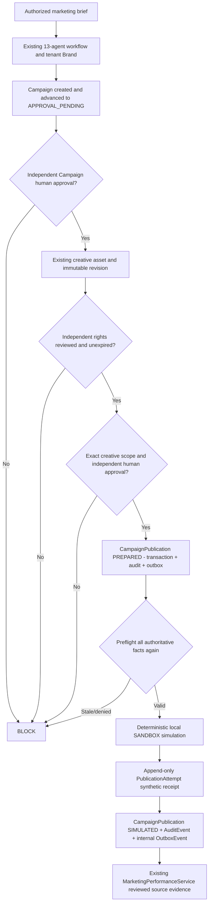

# R2 — Governed Campaign-to-Publication Execution, Sandbox Vertical Slice

**Scope:** Implement the first coherent, versioned, brand-bound campaign-to-creative-to-publication **internal staging workflow**. New code can prepare, validate, simulate, cancel and audit a *synthetic* social-platform publication request, with source-backed performance reads. It cannot deliver a real post, email, message, advertisement or external API request. This is deliberately not called a live social publishing integration.

## Mandatory Reuse Map

| Business fact | Sole authoritative owner / implementation | R2 linkage |
|---|---|---|
| Tenant, identity and permissions | Organization, User, BootstrapAuthGuard, TenantRolePolicyService | OIDC-only, session-verified tenant; existing MANAGE_CAMPAIGN / EXECUTE_WORKFLOW / READ_AUDIT |
| Brand identity and policy | Brand, BrandMasterRevision | A campaign may bind to one active tenant Brand; exact creative approval pins current approved Brand Master |
| Campaign brief, planning and state | MarketingWorkflowService, CampaignService, Campaign | Existing 13-agent assessment → Strategy → campaign creation → human Campaign approval. No second campaign engine |
| Creative, source and rights | CreativeAssetService, CreativeAssetRevision | Existing append-only DAM and independent rights review |
| Creative / Campaign decision | ApprovalService and Approval | Existing maker-checker decision ledger; exact asset approval digest and recorded human campaign approval both mandatory |
| *Desired* channel publication | New **CampaignPublication** aggregate | Exactly one prepared publication per approved creative-scope Approval, tied to one Campaign |
| Attempt/receipt evidence | Child **PublicationAttempt** table | Append-only **SANDBOX** evidence, never platform provider receipts |
| Internal reliable events | Existing OutboxEvent, OutboxPublisherService | Exactly two internal status event types for prepare and simulation; no external transport authorization |
| Metrics and attribution | Existing MarketingPerformanceService | Read **only separately ingested, independently reviewed** source data; sandbox impressions/leads/revenue are never invented |
| Commercial action permission | Existing packages/policy commercial scope | Live provider preflight **not wired** and disabled; cannot be bypassed through publication metadata |

**No duplicate brains, agents, approval ledger, credential table, event bus, metrics or provider connector.** The publication aggregate is genuinely new because a requested channel action and its attempt/receipt lifecycle have no authoritative owner.

## Supported end-to-end path

R2 does **not** transition a campaign to `LIVE` and does not claim social-platform delivery. A human may cancel an unexecuted `PREPARED` plan with a reason and optimistic version guard.

## Exact business logic

1. Campaign creation supports an optional active `brandId`, validated and constrained by composite tenant FK. Historical unbranded campaigns are preserved; they cannot be used for the new publication flow.
2. The campaign must be `APPROVED`, and a genuine Approval record must show a human decision `APPROVED` on that campaign. A direct state change without a recorded approval is insufficient.
3. The CreativeAssetRevision must be the latest version of an active Brand-owned CreativeAsset with independent rights review covering the *scheduled* time.
4. The current active Brand must match the campaign and the exact creative approval scope. The active BrandMasterRevision version must match `scope.policyVersion`.
5. Approval belongs to the same organization and revision, has `decision=APPROVED`, is unexpired, and its SHA-256 matches the canonical exact scope (source, media digest, audience, destination, channel and times).
6. Only the `SOCIAL` channel may enter the sandbox. `EMAIL`/`WEB` scopes remain blocked; no inbound consent source or live channel account is falsely inferred from its internal reference string.
7. `CampaignPublication` is unique per tenant request key **and** tenant Approval. Changing the request key cannot produce multiple intents for the same creative approval. An exact-key replay returns the recorded state without new audit/events.
8. Before simulation, the same facts are checked again **inside a serializable database transaction**. The versioned CAS update, append-only synthetic receipt, audit and internal outbox event commit or roll back together.
9. A second simulation of `SIMULATED` is a no-op replay. `CANCELLED`, wrong version, wrong tenant and stale scope requests fail closed.
10. `PublicationAttempt` SQL constraints accept only `mode=SANDBOX` and `SIMULATED/BLOCKED/OUTCOME_UNKNOWN` outcomes. An UPDATE/DELETE trigger makes attempts append-only.
11. `CampaignPublication` cannot enter `PUBLISHED` via its SQL status constraint. Identity/approval/source references are SQL-trigger immutable, even if a future consumer misbehaves.
12. Both new tables use FORCE RLS on transaction-local `app.marketing_tenant_id`. An independent non-BYPASSRLS role tests missing scope, own scope, foreign scope and pool context reset.

## UI path

The authenticated Marketing Command Center now carries Brand ID to the **existing** governed marketing workflow. Existing Creative Governance Studio creates, versions and reviews assets. The new **R2 Campaign-to-Publication Sandbox** shows eligible approved campaigns, accepts exact human creative Approval ID, prepares a plan, displays live rechecked reasons, creates a **local synthetic receipt only**, allows cancellation with rationale and compares only independently reviewed source metrics.

No `Publish` or `Send` control exists.

## Provider-agnostic live-publication blueprint — not yet implemented

An eventual adapter must declare explicit per-provider capabilities, destination account and webhook permissions, media source rights, rate limits, geographic restrictions, live approval identity and platform credential lifecycle. A future **server-trusted** authorization preflight must re-resolve all of:

- Active tenant and OIDC user/agency grants, subscription entitlements, brand rules and legal territory.
- SHA-256 of the **actual bytes** in verified object storage, not just a string declared in a draft.
- The exact live destination account/provider scope, post text/version, format, audience and schedule.
- Approved creative and campaign maker-checker, rights, scientific/regulatory claims and legal disclosures.
- Consent and suppression where channel/audience requires it, applicable platform terms and editorial constraints.
- Tenant spend/budget reservation for paid placements; permanent kill switches and rate limiting.
- A durable idempotency/attempt ledger with a transactionally recorded **OUTCOME_UNKNOWN** when the provider outcome is ambiguous. No blind repeat and no assumed delivery.
- Signed webhook validation and provider receipt reconciliation with duplicates, delays, delivery rejection and actual published-object lookup; store receipt-only evidence, not model-generated status.
- Source-reconciled attribution to campaign metrics with quarantine, independent review and causal claims explicitly distinguished.

Do not change SQL allowed statuses or add a network adapter until those gates, a production role without BYPASSRLS and staged end-to-end authorizations have passed. Provider backend cannot be connected merely by placing an access token in a model prompt.

## Quality, risk and acceptance

- Real PostgreSQL integration: Brand → Objective → Campaign creation → sequential transitions → independent Campaign decision → creative revision and rights → independent exact creative decision → publication prepare and sandbox simulation.
- Negative cases: tenant IDOR, simulated retry/double-run, missing original approval, wrong brand/version, expired rights and changed policy, stale CAS, unsupported channel, immutable receipt SQL trigger and truthful zero metrics.
- Direct SQL RLS via a non-BYPASSRLS role: missing context invisible; correct tenant sees its data; foreign tenant hidden; pooled transactions do not leak tenant state.
- CI covers fresh schema, historical migrations, Prisma drift, types, API/UI tests, build and evidence artifact.
- Real social credentials, developer/platform app reviews, media storage, external network publisher, live receipt reconciliation, universal tenant RLS, regional consent controls, security advisory issue #4 and ECC permissions issue #3 remain unimplemented or unresolved. **Not commercially production-ready**.

## Next engineering tranche

First authorize actual object-storage media SHA verification and destination-account OAuth using a provider-agnostic integration hub with tenant secret isolation. Implement certified consent/audience snapshots and one provider-specific staging-only publish adapter with signed receipts and webhooks, under the existing exact approval and Outbox/Inbox idempotency authority. A second staging and security review must precede enabling *any* live publishing flag.
